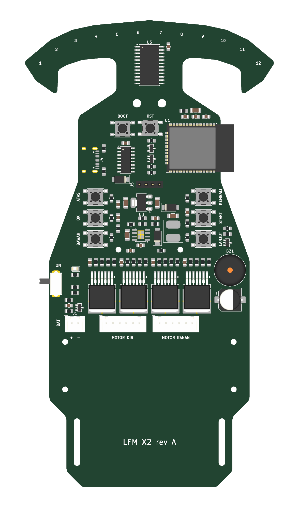

# LFM X2: PCB all-in-one full SMD (side project)

Dimulai 15/11/2026. **Side project di luar RAB PjBL**: rancangan utama (PCB sensor rev B + PCB utama rev B + board
interface rev B, RAB Rp937.390, charter) tidak berubah. X2 = satu PCB yang sekaligus jadi sasis, gaya Ichibot
Ultimate 5 Max: chip disolder langsung, tanpa modul DevKit/driver/buck.

**Status: skematik selesai (ERC 0), semua footprint sudah ditempatkan dan diberi net, JALUR BELUM ADA.** Jalur digambar
user sendiri di KiCad. Buka `lfm-x2.kicad_pro` (KiCad 10).



## Keputusan user (15/11)
| Hal | Pilihan |
|---|---|
| Kedudukan | side project paralel, dana sendiri |
| Papan | 1 PCB all-in-one (sensor, mux, MCU, driver, OLED, tombol) |
| MCU | modul ESP32-WROOM-32E + CH340C + USB-C + auto-reset + LDO 3,3 V di papan |
| Driver motor | 4× BTN7971B (TO-263-7) disolder langsung, 2 setengah H-bridge per motor |

## Isi folder
| File | Isi |
|---|---|
| `lfm-x2.kicad_sch`, `lfm-x2-skematik.pdf` | skematik 1 lembar A2, 5 blok, 132 komponen, 124 net |
| `lfm-x2.kicad_pcb` | outline + lubang + 132 footprint dengan net, 0 jalur, 0 pour |
| `lfm-x2.kicad_sym` | simbol proyek: `BTN7971B`, `CH340C_3V3` (pin V3 pasif), `MP1584EN` |
| `lfm-x2.kicad_pro` | net class: Default 0,3 mm; Daya 0,5 mm; Daya besar 1,2 mm. Jarak 0,3 mm, via 1,3/0,6 |
| `lfm-x2.kicad_dru` | jarak ke pour 0,5 mm + 2 pengecualian (lihat "Hasil cek") |
| `lfm-x2-peta-rakit-atas.pdf`, `-bawah.pdf` | lapisan Fab (referensi + nilai tiap komponen) untuk menyolder |
| `net-harapan.json` | net tiap pin menurut generator, dipakai `cek_net_x2.py` |
| `gambar/` | render 3D atas/bawah, gambar tata letak, `x2-ratsnest-sinyal.png` (sambungan terpendek tiap net sinyal) |

Skrip (di `hardware/tools/`):
```
py hardware/tools/gen_lib_x2.py                 # pustaka simbol
py hardware/tools/gen_sch_x2.py --paksa         # skematik (menimpa; UUID simbol dipertahankan)
py hardware/tools/cek_net_x2.py                 # net tiap pin skematik vs net-harapan.json
"C:/Program Files/KiCad/10.0/bin/python.exe" hardware/tools/gen_pcb_x2.py tata   # tata letak awal
"C:/Program Files/KiCad/10.0/bin/python.exe" hardware/tools/gen_pcb_x2.py pour   # GND pour sesudah routing
```
**Sesudah mulai menggambar jalur, jangan jalankan `tata` lagi**: perintah itu membuat ulang papan dari nol. Skrip
menolak kalau papan sudah berisi jalur (kecuali `--paksa`). Kalau skematik diubah sesudah routing, pakai F8 di KiCad.

## Rangkaian
1. **Daya**: J1 (pack Li-ion 2S, pin 1 = BAT+) → Q1 AO3401A (saklar beban sisi atas, SW1 hanya dialiri arus gate) →
   VBAT → 4 BTN7971B + C2 470 µF. U4 MP1584EN membuat 5,31 V (R6/R7 220k/39k, ±900 kHz, L1 15 µH), lewat D2 SS14 ke
   +5V; USB (VBUS) lewat D3 ke +5V juga, jadi papan hidup dari USB tanpa baterai. U3 AMS1117-3.3 → +3V3.
   VBAT_SENSE = VBAT × 33/133 ke GPIO39.
2. **MCU**: ESP32-WROOM-32E, CH340C dicatu 3,3 V (V3 disambung ke VCC), auto-reset 2× SS8050 (DTR/RTS → EN/IO0),
   tombol RST dan BOOT.
3. **Driver**: U6/U7 motor kiri, U8/U9 motor kanan. Tiap chip: R 4,7k seri di IN dan INH, R_SR 1k, R_IS 1k ke GND
   (arus motor belum dibaca), C 470 nF di VS. INH keempat chip = DRV_EN (GPIO2, pull-down 10k: driver mati saat boot).
   Maju: IN1 = PWM, IN2 = 0. Mundur: IN1 = 0, IN2 = PWM. Rem: keduanya sama.
4. **Sensor**: 12× QRE1113GR + CD74HC4067M, rangkaian dan posisi **sama persis dengan PCB sensor rev B**.
5. **Antarmuka**: OLED 0,96" I2C di socket, 5 tombol lewat tangga resistor di GPIO34 (nilai sama dengan board
   interface jalur utama), tombol ke-6 START sendiri di GPIO35, buzzer aktif + SS8050.

### Pin ESP32 (beda dari jalur utama hanya di motor)
| Fungsi | GPIO | | Fungsi | GPIO |
|---|---|---|---|---|
| MUX_SIG | 36 | | **ML_IN1 / ML_IN2** | **4 / 16** |
| VBAT_SENSE | 39 | | **MR_IN1 / MR_IN2** | **17 / 18** |
| MUX_S0 / S1 / S2 / S3 | 26 / 25 / 33 / 32 | | **DRV_EN** (INH 4 chip) | **2** |
| BTN (tangga 5 tombol) / BTN2 (START) | 34 / 35 | | ENC_L A / B | 13 / 14 |
| Buzzer | 12 | | ENC_R A / B | 23 / 19 |
| I2C SDA / SCL | 21 / 22 | | UART0 ke CH340C | 1 / 3 |

GPIO5, 15, 27 kosong. Urutan GPIO4/16/17/18 di baris kaki belakang ESP32 sama dengan urutan chip U6–U9 dari kiri
ke kanan, jadi keempat jalur IN bisa ditarik sejajar tanpa bersilangan. Jalur utama memakai TB6612 (PWMA/AIN1/AIN2 ...), jadi `Pins.h` X2 nanti berbeda di bagian motor:
4 kanal PWM (20 kHz masih di bawah batas 25 kHz BTN7971B) + 1 pin enable.

## Tata letak
Koordinat robot: x ke kanan, y maju, (0, 0) = tengah poros roda. KiCad X = 200 + x, Y = 180,55 − y (sama dengan
proyek PCB lain). Papan **94,5 × 177,1 mm, 112 cm²**; roda di luar papan (lebar robot ±115 mm).

| Zona | y (mm) | Isi |
|---|---|---|
| ekor | −46 … −13 | alas pack 50 × 30 × 15 mm + 2 celah strap 2,5 × 18 mm. Tidak ada komponen |
| motor | −12 … 12 | 2 motor N20 di atas PCB, 4 lubang M2 bracket di (±32; ±9). Tidak ada komponen |
| konektor | 12 … 19 | J1 baterai (kiri), J2 motor kiri, J3 motor kanan |
| driver | 19 … 41 | U6–U9 berjajar, tab ke belakang tepat di depan J2/J3, kaki ke depan; R/C tiap chip sebaris di depan kakinya. Kiri: Q1, SW1 (tuas keluar tepi kiri, ke depan = hidup), pembagi VBAT, LED daya. Kanan: C2, buzzer |
| antarmuka | 42 … 70 | OLED di socket J5 (tengah di y 56); di bawahnya buck (belakang) dan dioda 5 V + LDO (depan). Tombol kiri: ATAS, OK, BAWAH. Kanan: KEMBALI, START, LANJUT |
| MCU | 70 … 97 | ESP32 melintang, antena menonjol 5 mm keluar tepi kanan. USB-C di tepi kiri (dioda VBUS D3 di belakangnya), CH340C dan auto-reset di antaranya, BOOT dan RST di depannya, C3 (filter VBAT_SENSE) tepat di kaki GPIO39 |
| leher | 97 … 114 | 2 lubang M3 skid (±4,75; 99,5), mux U5 |
| sensor | 103 … 131 | 12 QRE1113GR + 24 resistor di **sisi bawah**, nomor 1–12 di silkscreen atas |

Sisi baris kaki ESP32 sudah menghadap tujuannya: sisi depan (GPIO36/39/34/35/32/33/25/26/14/12) ke mux dan tombol,
sisi belakang (GPIO4/16/17/18/19/21/22/23, RX/TX) ke driver, OLED, CH340C.

## Catatan untuk routing
- **Lebar**: net class sudah terpasang. VBAT, BAT+, ML_P/N, MR_P/N, BUCK_SW minimal 1,2 mm; lebih enak pakai isian
  tembaga (zone) dari tab BTN7971B ke pin J2/J3 yang jaraknya cuma ±5 mm. +5V, +3V3, GND, VBUS 0,5 mm.
- **Jalur VBAT**: Q1 (kiri) → menyusur depan kaki BTN7971B (lorong 1,7 mm antara ujung kaki dan baris R/C, atau lewat
  sisi bawah) → kaki 7 tiap chip → C2 (kanan) → C4/U4 di bawah OLED. Kaki 1 (GND) tiap chip bersebelahan dengan kaki 7
  chip tetangganya; kapasitor 470 nF (C16–C19) sudah diletakkan di depan kaki 7.
- **Buck**: kalang C4 → U4 kaki 7 → kaki 1 (SW) → D1 → GND sependek mungkin. Net BUCK_SW (U4.1, D1.K, L1.1, C6)
  jangan dipanjangkan. Jalur BUCK_FB (R6/R7) jauhkan dari L1 dan D1. Pad bawah U4 (pin 9) = GND.
- **Antena**: footprint U1 membawa daerah larangan sendiri (x > 25,8; y 58 … 107): tidak boleh ada jalur, via, pour.
  Tombol kanan berhenti di x 25,6, jadi tidak kena.
- **USB**: D+ dan D− dari J4 langsung ke U2 kaki 5 dan 6 (sisi kiri U2), sejajar dan pendek.
- **Jalur panjang** (wajar lewat sisi bawah): encoder J2/J3 → ESP32 (58–77 mm, lewat bawah deretan BTN7971B),
  BTN (131 mm, dua kolom tombol), VBAT_SENSE dari R3/R4 di kiri belakang ke GPIO39 (84 mm), BUZ (46 mm),
  TX/RX dari sisi kiri U2 memutar ke baris kaki belakang ESP32 (33 mm).
- **Busur sensor**: posisi dan net 122 pad (12 sensor, 24 resistor, mux, C20) sudah dicek sama dengan
  `hardware/sensor-garis` rev B. Pola jalur rev B bisa ditiru persis; nama net anoda berbeda (rev B `Net-(Un-A)`, X2
  `A1`…`A12`).
- **Di bawah motor** (y −12 … 12): badan motor logam menempel di papan. Jalur di sisi atas zona ini sebaiknya
  dihindari (pakai sisi bawah) atau motor diberi alas isolasi.
- **GND pour** dua sisi sesudah routing: `gen_pcb_x2.py pour` atau gambar zone sendiri (jarak ke pour 0,5 mm sudah
  ada di `.kicad_dru`).
- **Jangan "Update Footprints from Library"** untuk SW1 (pad pemasang dikecilkan 2,2 × 3,5 → 2,0 × 3,3 supaya jarak
  ke kaki ≥ 0,3 mm), U1 (12 via termal bor 0,2 mm dibuang, di bawah bor minimum 0,6 mm) dan J4 (garis silk dipindah).

## Daftar komponen
Harga dari pencarian Tokopedia 15/11/2026 (bisa berubah); yang bertanda ± belum dicari, hanya perkiraan.

| Komponen | Ref | Jml | Harga satuan | Toko / catatan |
|---|---|---|---|---|
| ESP32-WROOM-32E (modul polos, 4 MB) | U1 | 1 | Rp50.000 | [WNT Electronics](https://www.tokopedia.com/wnte/esp32-wroom-32e); antena PCB, bukan varian IPEX (32UE) |
| BTN7971B TO-263-7 | U6–U9 | 4 | Rp45.000 | [Jogjarobotika](https://www.tokopedia.com/jogjarobotika/btn7971b-to263-driver-motor-ic-btn7971-btn-7971); cadangan [Nugarada](https://www.tokopedia.com/nugarada/btn7971b-btn-7971-b-btn7971-b-to263-driver-motor-ic) Rp60.000 |
| QRE1113GR | IR1–IR12 | 12 | Rp15.000 | sama dengan RAB jalur utama |
| CD74HC4067M SOP-24 lebar (SOIC) | U5 | 1 | Rp20.000 | WKH Electronic, sama dengan jalur utama; hindari SSOP |
| CH340C SOP-16 | U2 | 1 | Rp8.500 | [DR Elektronik](https://www.tokopedia.com/elektronikdr/ic-ch340c-usb-to-serial-chip-sop-16-ch340g-ch340-ch-340-sop16-wch); harus **C** (kristal di dalam), bukan G |
| USB-C 16 pin SMD | J4 | 1 | Rp3.000 | [Jogjarobotika](https://www.tokopedia.com/jogjarobotika/konektor-connector-soket-socket-tipe-type-c-female-usb-3-1-16p-smd); cocokkan dengan footprint HRO TYPE-C-31-M-12 |
| MP1584EN SOP-8 (pad bawah) | U4 | 1 | Rp7.500 | [Central Electronics](https://www.tokopedia.com/celectro/ic-smd-mp1584-mp1584en-3a-1-5mhz-28v-step-down-converter-sop8-ic-bc00) |
| AO3401A SOT-23 | Q1 | 1 | Rp1.650 | [Lisu Instruments](https://www.tokopedia.com/lisuinstrument/ao3401a-ao3401-30v-4a-p-channel-mosfets-sot-23-alpha-omega-original) |
| Tombol tactile SMD 6×6, 4 kaki | SW2–SW9 | 8 | Rp8.000 / 10 pcs | [ichibot](https://www.tokopedia.com/ichibot/push-button-tact-switch-micro-switch-6x6x5-smd-4p-4-pin-6-6-5-tombol); untuk 6 tombol menu lebih enak yang tinggi 7–8 mm (OLED di socket ±11 mm) |
| Induktor daya SMD 15 µH ≥ 2 A, 7,8 × 7 mm (CD75) | L1 | 1 | ± Rp3.000 | **belum ketemu** yang 15 µH satuan; 10–22 µH juga bisa (cari "CD75 150") |
| AMS1117-3.3 SOT-223 | U3 | 1 | ± Rp1.500 | |
| SS34 (SMA) / SS14 (SMA) | D1 / D2, D3 | 1 / 2 | ± Rp500 | |
| SS8050 SOT-23 (kode Y1) | Q2–Q4 | 3 | ± Rp300 | |
| Elko SMD 470 µF 16 V, 8 × 10,5 mm | C2 | 1 | ± Rp2.000 | |
| Kapasitor 1206: 10 µF 25 V / 22 µF 16 V | C4, C9, C14 / C7, C10 | 3 / 2 | ± Rp500 | |
| Kapasitor 0805: 100 nF / 470 nF / 1 µF / 150 pF | | 10 / 4 / 1 / 1 | ± Rp100 | |
| Resistor 0805: 220 / 1k / 3,9k / 4,7k / 5,1k / 8,2k / 10k / 18k / 33k / 39k / 100k / 220k | | 12 / 11 / 1 / 8 / 2 / 1 / 21 / 1 / 1 / 2 / 4 / 1 | ± Rp100 | 65 buah |
| LED 0805 hijau | LED1 | 1 | ± Rp200 | |
| Saklar geser SPDT siku (SS12D00 siku / OS102011MA1Q) | SW1 | 1 | ± Rp1.500 | THT; cocokkan jarak kaki 2,0 mm |
| JST XH 2 pin / 6 pin (header + housing) | J1 / J2, J3 | 1 / 2 | Rp5.000 / set | THT |
| Socket female 1×4 2,54 mm | J5 | 1 | ± Rp1.000 | THT |
| Buzzer aktif 5 V 12 × 9,5 mm | BZ1 | 1 | Rp3.000 | THT |
| OLED 0,96" I2C | | 1 | Rp36.500 | sama dengan jalur utama |
| Motor N20 6 V 500 RPM + encoder | | 2 | Rp55.000 | sama dengan jalur utama |

Yang sudah ada harganya: **± Rp618.000**; pasif dan komponen kecil ± Rp40.000. Belum termasuk cetak PCB 112 cm²,
pack baterai, roda, bracket motor, baut.

## Pilihan yang diambil Claude (bisa diubah)
- **Saklar beban Q1 AO3401A** (bukan saklar langsung di jalur baterai): SW1 kecil cukup, tapi Q1 SOT-23 membatasi arus
  kontinu ±2 A (Rds ±45 mΩ, angka konservatif). Cukup untuk 2 N20; kalau motor diganti yang lebih besar, Q1 harus diganti. R2 10k:
  Vgs = −0,91 × VBAT (maks −7,6 V), jadi **hanya untuk 2S**. Tidak ada proteksi polaritas terbalik.
- **R seri IN/INH 4,7k** (datasheet contoh 10k), R_SR 1k, R_IS 1k.
- **6 tombol menu 3 + 3** seperti Ichibot (5 di tangga + START di GPIO35), ditambah RST dan BOOT. Urutan nama tombol
  hanya silkscreen + firmware, gampang diganti.
- **Masih THT**: J1–J3, J5, SW1, buzzer (konektor dan saklar SMD mudah copot). SW1 bisa diganti MSK-12C02 (SMD)
  kalau mau benar-benar tanpa THT.
- **Pembagi baterai 100k/33k** dan buck 5,31 V mengikuti rekomendasi `docs/perhitungan-motor.md`.
- **Cas baterai di luar robot**; tidak ada charger/BMS di papan.
- **Antena ESP32 menonjol 5 mm** dari tepi kanan (di dalam lebar roda dan sayap sensor).
- Ekor hanya alas baterai. Kalau mau hemat cetak, papan bisa dipotong di y −13 (−21 cm²) dan baterai dipikul
  dudukan 3D print.

## Belum dicek / perlu diukur sebelum cetak
1. **USB-C 16 pin tidak lolos aturan tempat cetak**: pad 0,3 mm berjarak 0,5 mm → celah 0,2 mm, batas tempat cetak
   0,254 mm. Tidak bisa diperbaiki dengan mengubah pad (0,3 mm sudah lebar minimum). Tanyakan ke tempat cetak, atau
   ganti konektor (mini-USB jarak 0,8 mm lolos; micro-USB 0,65 mm lolos kalau pad dikecilkan ke 0,35 mm).
2. Jarak lubang bracket N20 (digambar 18 mm, x ±32) dan panjang motor + encoder (digambar 33 mm).
3. Jarak lubang modul OLED (2 lubang M2 di (±11,75; 44), dari gambar umum modul) dan urutan pin (J5: GND, VCC, SCL, SDA).
4. Tinggi skid depan: dengan motor di atas papan, papan miring ±3° (bawah papan ±10 mm di poros, ±4 mm di sensor),
   skid di y 99,5 perlu ±5 mm. Ball caster biasa terlalu tinggi.
5. Pad bawah ESP32 (pin 39, GND) tidak punya via; solder dengan hot air atau biarkan (GND juga di pin 1, 15, 38).
6. Datasheet BTN7971B hanya terbaca dari salinan HTML (beberapa kolom min/typ/max meragukan); angka yang dipakai
   (kaki, VIH ≤ 2,15 V, operasi sampai 4,5 V, PWM ≤ 25 kHz) konsisten dengan product brief Infineon.
7. Belum ada firmware, simulasi, atau uji apa pun untuk X2.

## Hasil cek (15/11)
- ERC: 0 pelanggaran. `cek_net_x2.py`: 132 komponen, 398 pin, 124 net, semua cocok.
- DRC `kicad-cli pcb drc --schematic-parity`: 0 error, parity 0, 323 sambungan belum dirouting (memang belum ada
  jalur), 19 peringatan celah pad USB-C (butir 1 di atas), 3 peringatan footprint beda dari pustaka (SW1, U1, J4,
  disengaja). Tidak ada courtyard bertumpuk atau komponen keluar tepi.
- `.kicad_dru`: pad bawah U4 ke kakinya 0,295 mm, dilonggarkan ke batas tempat cetak 0,254 mm (angka proyek 0,3).

## Referensi
Foto Ichibot Ultimate 5 Max dari user di `docs/referensi/ichibot-ultimate-5-max/`. Yang ditiru: 4 BTN7971B berjajar
dengan resistor di depan kakinya, tombol 3 + 3 mengapit OLED, modul ESP32 + USB-C di papan. Yang berbeda: Ichibot
memakai beberapa papan di body 3D print (papan utama segitiga, papan driver, papan tombol); X2 satu papan memanjang
termasuk busur sensor dan alas baterai, jadi siluetnya tidak segitiga.
