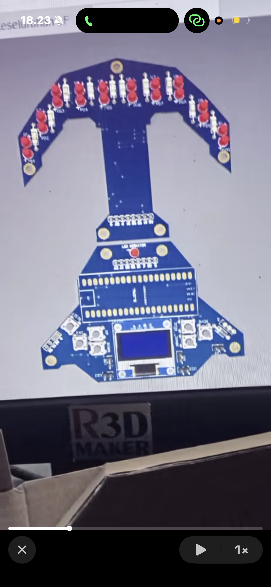
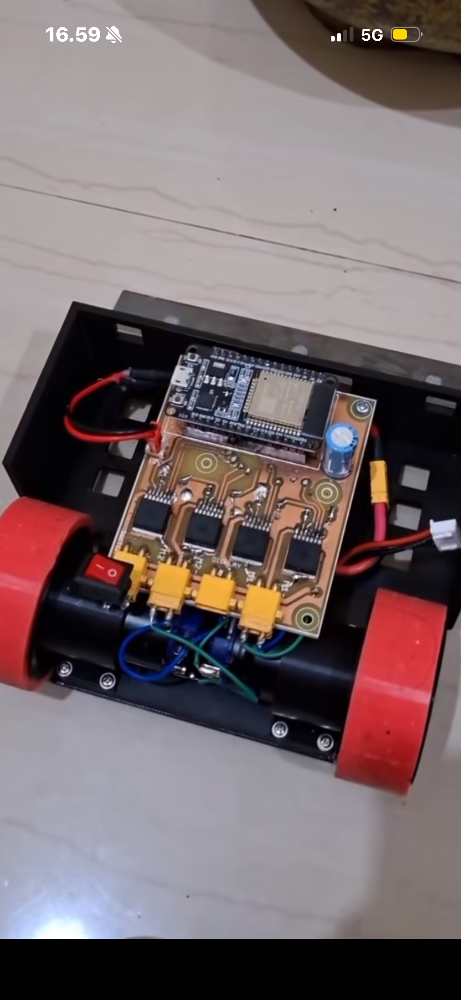
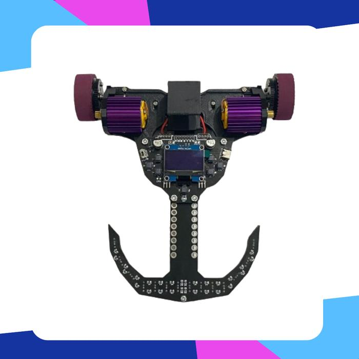
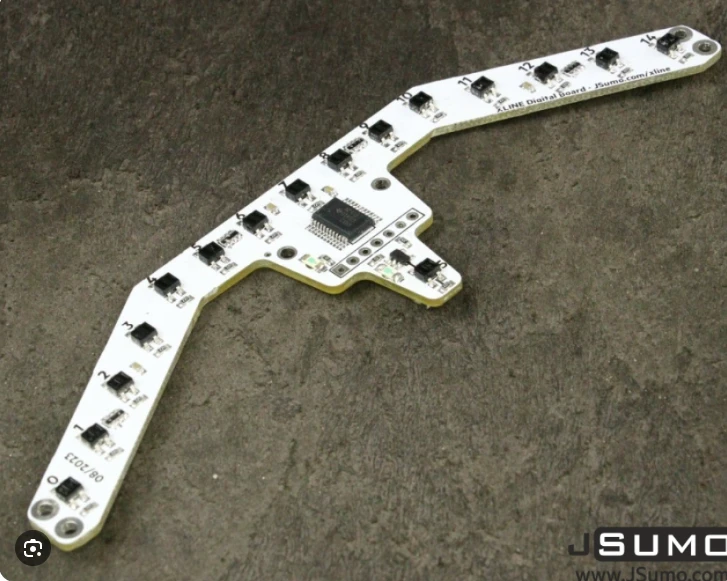

# Referensi Desain PCB

Disimpan 08/10/2026 atas permintaan kelompok: arah desain PCB **mengikuti referensi ini**, bukan
"tempel modul" (modul breakout driver/buck ditancap atau ditempel di PCB dianggap kurang proper).

## 1. `ref-pcb-r3dmaker-lf.png` — PCB line follower (R3D Maker)

Yang terlihat:
- **Papan sensor berbentuk sayap/busur** di depan dengan ± 14 pasang sensor diskrit through-hole
  (LED + fototransistor + resistor) langsung di PCB, bukan modul sensor.
- **Leher panjang** dari sayap ke papan utama; sambungan antar papan lewat **header 8 pin** (board-to-board).
- Papan utama: **footprint ESP32 DevKit 38 pin disolder langsung** (2 × 19 pin), **OLED** di bagian bawah,
  ± 6 tombol (menu), LED indikator, konektor motor/daya di sisi.
- Bentuk PCB custom (bukan kotak), lubang baut di tiap ujung.

## 2. `ref-pcb-esp32-driver-ic.png` — PCB kontrol robot dengan IC driver

Yang terlihat:
- **ESP32 DevKit** dipasang di PCB custom.
- **Driver motor berupa IC SMD yang disolder langsung** (4 chip), bukan modul breakout.
- Konektor **XT30** untuk motor/daya, kapasitor elektrolit besar di jalur daya, saklar rocker.

## Kesimpulan untuk desain kita (minsys "semi-terintegrasi")

| Bagian | Dipakai | Catatan |
|---|---|---|
| ESP32 | **DevKit disolder langsung** (seperti kedua referensi) | Tidak perlu merancang USB-serial & auto-reset sendiri |
| Driver motor | **IC TB6612FNG (SSOP-24) disolder langsung** | Kaki rapat 0,65 mm: solder pakai flux + teknik drag, atau jasa PCBA |
| Regulator 5 V | **IC buck (mis. MP1584EN, SOIC-8) + induktor + kapasitor** di PCB | Rangkaian ikut datasheet |
| Sensor garis | **Komponen diskrit** (ITR20001 / pasangan LED IR + fototransistor) di PCB sensor | Seperti referensi 1 |
| OLED + tombol | OLED modul disolder + tombol di PCB | Seperti referensi 1 |
| Baterai, BMS, charger | Tetap modul, di dekat holder baterai | Bisa diintegrasikan di versi berikutnya |
| Sambungan papan sensor ↔ utama | Header board-to-board | Seperti referensi 1 |

## 3. `ref-lf-edu-esp32-14sensor.png` — Robot Pembelajaran Line Follower Educational (pesaing)

Dari deskripsi produk: ESP32, **14 sensor photodiode**, OLED 1.3", pilihan desain modular/non-modular,
driver motor MOSFET / BTN 70A, pemrograman **Blockly IoTA dari PC/laptop**, 2 EEPROM eksternal
(31 memori lintasan × 99 "planning/index/counter"), PID, kontrol manual via Bluetooth, usia 8+.

Catatan analisis:
- 14 sensor analog > jumlah ADC ESP32 → kemungkinan besar memakai **multiplexer analog 16 kanal
  (CD74HC4067)** atau ADC eksternal. Perlu dicek kalau ada foto PCB sisi bawah.
- "Planning" di produk ini = urutan aksi yang **diisi manual** per persimpangan (gaya lomba LF Indonesia),
  **bukan** pencarian rute otomatis. Path planning kita (rute terpendek dihitung robot) berbeda.
- Produk ini **sudah memakai block coding (Blockly)** → block coding saja bukan pembeda; pembeda kita:
  harga, path planning otomatis, fokus anak sekolah, web tanpa instalasi aplikasi.

## 4. `ref-jsumo-xline.png` — JSumo XLINE 16 Line Sensor Board (acuan bentuk PCB sensor, 20/10/2026)

Dipilih kelompok 20/10/2026 sebagai acuan **bentuk PCB sensor** (model 3D v15). Foto memperlihatkan sisi sensor.
- Pita sempit bentuk sayap camar: bagian tengah lurus + 2 sayap miring ke belakang, nomor sensor 0–15.
- Badan tengah membawa IC (pada kita: modul mux CD74HC4067) + header, tab kecil di belakang (XLINE: sensor ke-16).
- 2 lubang baut di tiap ujung sayap.
- Data penjual: 16 sensor, 138,75 × 36,75 × 6 mm, 5 V, ±240 mA untuk 16 sensor.

Yang dipakai di v15: bentuk dan susunan (12 QRE1113GR: 6 di tengah, 3 per sayap 30°, jarak 9,5 mm), warna hitam
(bukan putih), tanpa sensor ke-16.
