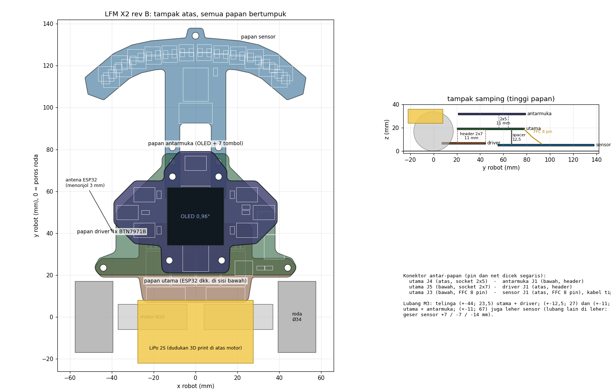
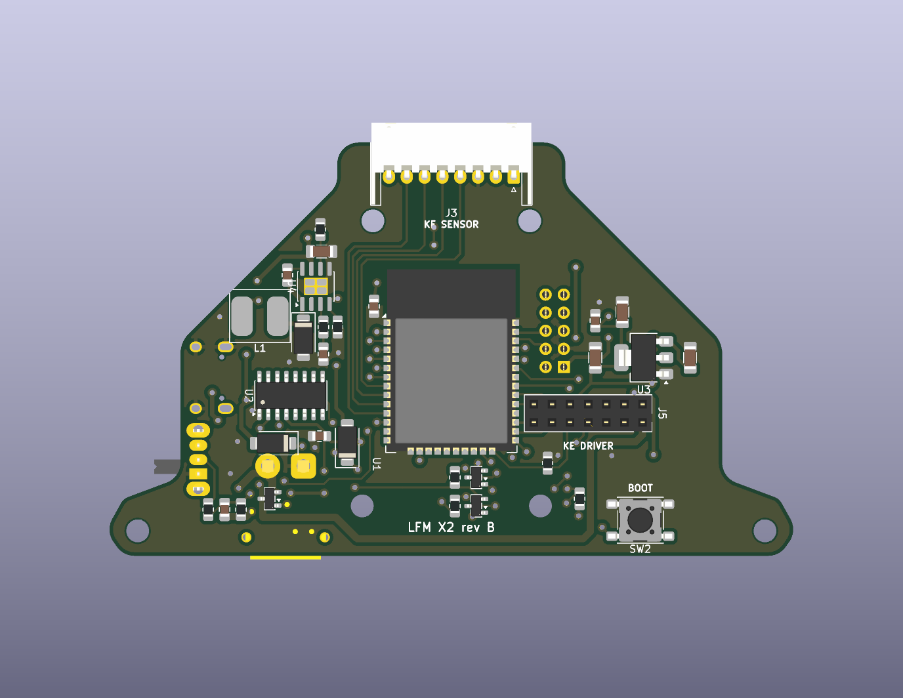
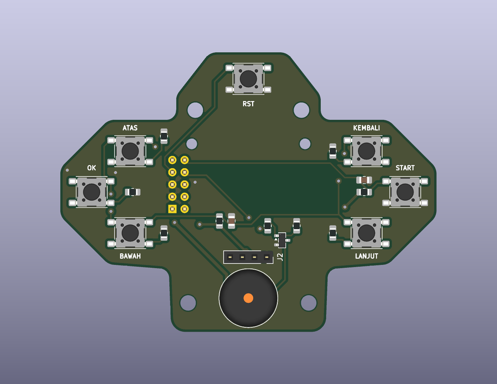
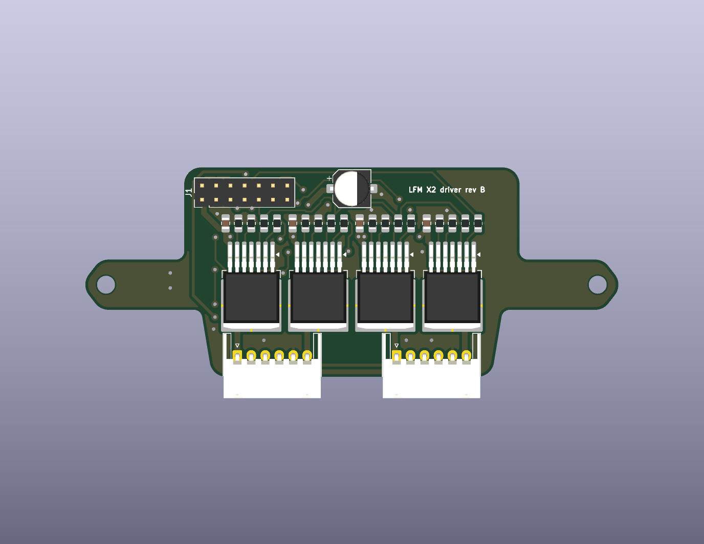

# LFM X2 rev B: 4 papan full SMD gaya Ichibot (side project)

Dimulai 15/11/2026. **Side project di luar RAB PjBL, dana sendiri**: rancangan utama (PCB sensor rev B + PCB utama
rev B + board interface rev B, RAB Rp937.390, charter) tidak berubah.

**Rev B (rombak 15/11)** meniru susunan Ichibot Ultimate 5 Max: papan utama segitiga (ESP32 dan hampir semua komponen
di sisi bawah), papan antarmuka (OLED + tombol) ditumpuk di atasnya, papan driver 4× BTN7971B di bawah bagian
belakangnya, papan sensor bulan sabit di depan, baterai LiPo 2S kecil di dudukan 3D print di atas motor. Rev A (satu
PCB memanjang) dipindah ke `arsip/hardware/lfm-x2-rev-a/`.

**Status: skematik keempat papan selesai (ERC 0), semua footprint sudah ditempatkan dan diberi net, JALUR BELUM ADA.**
Jalur digambar user sendiri di KiCad 10. Tiap papan = proyek KiCad sendiri (lihat "Isi folder").



## Keputusan user
| Tanggal | Hal | Pilihan |
|---|---|---|
| 15/11 | Kedudukan | side project paralel, dana sendiri |
| 15/11 | MCU | modul ESP32-WROOM-32E + CH340C + USB-C + auto-reset + LDO 3,3 V di papan |
| 15/11 | Driver motor | 4× BTN7971B (TO-263-7), 2 setengah H-bridge per motor |
| 15/11 | Susunan | gaya Ichibot: papan utama segitiga + antarmuka + driver terpisah + sensor bulan sabit, LiPo 2S kecil |
| 15/11 | Sensor | **12 sensor**, fototransistor **Everlight PT67-21B** (3528 PLCC, lensa hitam, 940 nm) + **LED IR 940 nm 3528** (8 mW/sr @100 mA, temuan user); photodioda 3528 tidak ketemu |
| 15/11 | OLED | 0,96" I2C |

## Isi folder
| Path | Isi |
|---|---|
| `utama/lfm-x2-utama.kicad_pro` | papan utama: daya (saklar beban, buck 5 V, LDO 3,3 V), ESP32, USB-C + CH340C, 3 konektor antar-papan. 50 komponen (44 di sisi bawah) |
| `antarmuka/lfm-x2-antarmuka.kicad_pro` | OLED di socket, 7 tombol (ATAS/OK/BAWAH, KEMBALI/START/LANJUT, RST), buzzer. 22 komponen |
| `driver/lfm-x2-driver.kicad_pro` | 4× BTN7971B + R/C, elko 100 µF, 2 konektor motor + encoder. 28 komponen |
| `sensor/lfm-x2-sensor.kicad_pro` | 12 LED IR + 12 PT67-21B (sisi bawah), 24 resistor, CD74HC4067M, FFC. 51 komponen |
| `<papan>/lfm-x2-<papan>-skematik.pdf` | skematik |
| `<papan>/lfm-x2-<papan>-peta-rakit-atas.pdf`, `-bawah.pdf` | lapisan Fab (referensi + nilai) skala 2:1 untuk menyolder; sisi bawah dicermin |
| `<papan>/net-harapan.json` | net tiap pin menurut generator, dipakai `cek_net_x2.py` |
| `lfm-x2.kicad_sym` | simbol bersama: `BTN7971B`, `CH340C_3V3` (pin V3 pasif), `MP1584EN` |
| `lfm-x2.pretty/` | footprint bersama: `PLCC-2_3528_HandSolder` (LED IR dan PT67-21B) |
| `gambar/` | `x2b-susunan.png` (tampak atas bertumpuk + tampak samping), render 3D tiap papan |

Tiap proyek: net class Default 0,3 mm, Daya 0,5 mm, Daya besar 1,2 mm; jarak 0,3 mm; via 1,3/0,6; `.kicad_dru` jarak
ke pour 0,5 mm (aturan tempat cetak).

Skrip (di `hardware/tools/`, jalankan dari folder repo; `KPY="C:/Program Files/KiCad/10.0/bin/python.exe"`):
```
py hardware/tools/gen_lib_x2.py                          # simbol + footprint bersama
py hardware/tools/gen_sch_x2.py [papan ...] [--paksa]    # skematik (menimpa; UUID simbol dipertahankan)
py hardware/tools/cek_net_x2.py [papan ...]              # ERC + net tiap pin + konektor antar-papan
"$KPY" hardware/tools/gen_pcb_x2.py tata [papan ...]     # tata letak awal (papan utama dulu)
"$KPY" hardware/tools/gen_pcb_x2.py peta [papan ...]     # peta rakit PDF
"$KPY" hardware/tools/gen_pcb_x2.py pour papan           # GND pour dua sisi sesudah routing
```
**Sesudah mulai menggambar jalur, jangan jalankan `tata` lagi** untuk papan itu: perintah itu membuat ulang papan dari
nol (skrip menolak kalau papan sudah berisi jalur, kecuali `--paksa`). Kalau skematik diubah sesudah routing, pakai F8
di KiCad.

## Susunan dan konektor antar-papan
Koordinat robot: x ke kanan, y maju, (0, 0) = tengah poros roda; KiCad X = 200 + x, Y = 180,55 − y di keempat proyek,
jadi papan bisa ditumpuk langsung dari koordinatnya.

| Papan | Ukuran | z (mm dari lantai) | Dipasang ke |
|---|---|---|---|
| sensor | 105 × 83 mm, bulan sabit + leher garpu | 4,5 … 6,1 | lengan leher (x ±11) ke lubang papan utama (±11; 67) lewat spacer 12,5 mm; baut skid nilon di tonjolan depan (0; 134,3) |
| driver | 95 × 37,5 mm, 2 telinga | 6,0 … 7,6 | header 2×7 ke socket papan utama + 2 telinga (±44; 23,5) spacer 11 mm ke telinga papan utama dan rangka |
| utama | 96 × 58 mm, segitiga | 18,6 … 20,2 | telinga (±44; 23,5) ke rangka 3D print |
| antarmuka | 78 × 58 mm | 31,2 … 32,8 | header 2×5 ke socket papan utama + 4 spacer 11 mm di (±12,5; 27) dan (±11; 67) |

Jarak 11 mm = socket 8,5 mm + plastik header 2,54 mm. Leher sensor punya 4 lubang tiap sisi berjarak 7 mm
(y 60/67/74/81): lubang 67 = posisi rancangan; memakai lubang lain menggeser busur sensor +7 / −7 / −14 mm.

| Konektor | Pin (net) | Cek |
|---|---|---|
| utama J3 (sisi bawah) ↔ sensor J1 (sisi atas): FFC 8 pin 1,0 mm | 1 +5V, 2 +3V3, 3 GND, 4–7 MUX_S3…S0, 8 MUX_SIG (urutan sama dengan J1 PCB sensor jalur utama) | pin bernomor sama segaris di x (−3,5 … 3,5), kabel lurus tanpa terpuntir: **kabel FFC tipe B** (kontak di sisi berlawanan di kedua ujung, karena satu konektor terbalik di sisi bawah), ±5 cm |
| utama J4 (atas, socket 2×5) ↔ antarmuka J1 (bawah, header 2×5) | 1 +5V, 2 +3V3, 3–4 GND, 5 SDA, 6 SCL, 7 BTN, 8 BTN2, 9 BUZ, 10 EN | posisi pin + net dicek sama |
| utama J5 (bawah, socket 2×7) ↔ driver J1 (atas, header 2×7) | 1–2 VBAT, 3–4 GND, 5 ML_IN1, 6 ML_IN2, 7 MR_IN1, 8 MR_IN2, 9 DRV_EN, 10 +3V3, 11–14 ENC_L_A/B, ENC_R_A/B | posisi pin + net dicek sama |

## Rangkaian
1. **Daya (utama)**: J1 LiPo 2S → Q1 AO3401A (saklar beban sisi atas, SW1 hanya dialiri arus gate) → VBAT → J5 ke
   driver + C3/C4 + U4. U4 MP1584EN membuat 5,31 V (R6/R7 220k/39k, ±900 kHz, L1 15 µH), lewat D2 SS14 ke +5V; USB
   (VBUS) lewat D3 ke +5V juga, jadi papan hidup dari USB tanpa baterai (motor tidak). U3 AMS1117-3.3 → +3V3.
   VBAT_SENSE = VBAT × 33/133 ke GPIO39 (C2 100 nF).
2. **MCU (utama)**: ESP32-WROOM-32E, CH340C dicatu 3,3 V (V3 disambung ke VCC), auto-reset 2× SS8050, tombol BOOT di
   sisi bawah papan utama, tombol RST di papan antarmuka (net EN lewat J4). Pull-down 10k di DRV_EN (GPIO2) dan BUZ
   (GPIO12): driver mati dan buzzer diam saat boot.
3. **Driver**: U1/U2 motor kiri, U3/U4 motor kanan. Tiap chip: R 4,7k seri di IN dan INH, R_SR 1k, R_IS 1k ke GND
   (arus belum dibaca), C 470 nF di VS; C5 100 µF di VBAT. INH keempat chip = DRV_EN. Maju: IN1 = PWM, IN2 = 0;
   mundur: kebalikannya; rem: keduanya sama. Encoder N20 dicatu 3,3 V dari J2/J3 pin 2.
4. **Sensor**: tiap titik = LED IR (anoda ← R 220 Ω ← +5V, ±17 mA; katoda → GND) + PT67-21B (kolektor ← R 10k ←
   +3V3 = sinyal Sn; emitor → GND). Gelap (garis hitam) = arus PT kecil = tegangan Sn tinggi. S1–S12 = I2–I13
   CD74HC4067M (sama dengan PCB sensor jalur utama), COM → MUX_SIG (GPIO36). Posisi 12 titik = busur PCB sensor rev B
   (`hardware/sensor-garis/REVISI.md`), LED 2 mm di depan busur, PT 2 mm di belakangnya, resistor di sisi atas.
5. **Antarmuka**: OLED 0,96" I2C di socket J2 (deret pin di belakang, modul diputar 180°: balik tampilan di firmware),
   5 tombol tangga resistor di GPIO34 (ATAS 1k, BAWAH 3,9k, KEMBALI 8,2k, OK 18k, LANJUT 39k; pull-up 10k), START
   sendiri di GPIO35, buzzer aktif + SS8050 di GPIO12.

### Pin ESP32 (sama dengan rev A; beda dari jalur utama hanya di motor)
| Fungsi | GPIO | | Fungsi | GPIO |
|---|---|---|---|---|
| MUX_SIG | 36 | | **ML_IN1 / ML_IN2** | **4 / 16** |
| VBAT_SENSE | 39 | | **MR_IN1 / MR_IN2** | **17 / 18** |
| MUX_S0 / S1 / S2 / S3 | 26 / 25 / 33 / 32 | | **DRV_EN** (INH 4 chip) | **2** |
| BTN (tangga 5 tombol) / BTN2 (START) | 34 / 35 | | ENC_L A / B | 13 / 14 |
| Buzzer | 12 | | ENC_R A / B | 23 / 19 |
| I2C SDA / SCL | 21 / 22 | | UART0 ke CH340C | 1 / 3 |

`Pins.h` X2 nanti beda dari jalur utama di bagian motor: 4 kanal PWM (20 kHz, di bawah batas 25 kHz BTN7971B) + 1 pin
enable.

## Tata letak (ringkas)
- **Utama**: ESP32 di sisi bawah, melintang di bahu kiri, antena menonjol 3 mm keluar tepi kiri. Baris kaki 1–14
  (MUX, VBAT, BTN, BUZ, ENC_L) menghadap depan ke J3/J4; baris 25–38 (IN motor, SDA/SCL, ENC_R, RX/TX) menghadap
  belakang ke J5 dan CH340C. Bahu kanan: USB-C dan SW1 (tuas keluar tepi kanan) di sisi atas, CH340C + R CC + D3 di
  bawahnya. Kanan depan: buck. Tengah: LDO + D2. Kanan belakang: J1 baterai + LED daya (atas), Q1 (bawah). Ujung
  segitiga: J3 FFC (bawah) dengan mulut ke depan, tepat di tepi.
- **Antarmuka**: OLED di tengah, tombol 3 + 3 mengapitnya, RST di tab depan, buzzer di tab belakang (tidak di bawah
  OLED karena tinggi 9,5 mm). J1 di sisi bawah, tepat di atas J4 papan utama.
- **Driver**: 4 BTN7971B berjajar, tab ke belakang, R/C tiap chip sebaris di depan kakinya, J2/J3 di tepi belakang.
- **Sensor**: LED + PT di sisi bawah, nomor 1–12 di silkscreen kedua sisi (1 = paling kiri dilihat dari atas). Mux
  di leher, FFC J1 di bawahnya dengan mulut menghadap celah garpu.

 
 
 

## Catatan untuk routing
- **Lebar**: net class sudah terpasang. VBAT, BAT+, ML_P/N, MR_P/N, BUCK_SW minimal 1,2 mm; di driver lebih enak
  pakai isian tembaga (zone) dari tab BTN7971B ke pin J2/J3. +5V, +3V3, GND, VBUS 0,5 mm.
- **Buck**: kalang C3 → U4 kaki 7 → kaki 1 (SW) → D1 → GND sependek mungkin; BUCK_FB (R6/R7) jauhkan dari L1 dan D1.
  Pad bawah U4 (pin 9) = GND.
- **Antena**: area aturan "Antena ESP32" (x −42 … −33,8; y 30,5 … 50,5) melarang jalur, via, dan pour di kedua sisi.
  Keepout bawaan footprint (48 × 21 mm, ikut melarang footprint) dibuang karena menutup telinga kiri dan lubangnya.
- **USB**: D+ dan D− dari J2 langsung ke U2, sejajar dan pendek.
- **Sensor**: tiap titik butuh via dari pad LED/PT (bawah) ke resistornya (atas). Net anoda `A1`…`A12`, sinyal
  `S1`…`S12`.
- **GND pour** dua sisi sesudah routing: `gen_pcb_x2.py pour <papan>` atau gambar zone sendiri.
- **Jangan "Update Footprints from Library"** untuk utama U1 (via termal bor 0,2 mm, keepout, dan courtyard antena
  dibuang), SW1 (pad pemasang dikecilkan ke 2,0 × 3,3 supaya jarak ke kaki ≥ 0,3 mm) dan J2 (garis silk dipindah ke
  Fab). Peringatan "footprint beda dari pustaka" di papan sensor hanya pembulatan rotasi miring, aman.

## Daftar komponen (keempat papan)
Harga dari pencarian Tokopedia 15/11/2026 (bisa berubah; harga rev B dari cuplikan hasil pencarian karena halaman
produk tidak bisa dibuka dari laptop); "belum dicari" = harga belum ada. PT67-21B dan LED IR 3528 tidak muncul di
pencarian: link listing temuan user belum dicatat.

| Komponen | Papan: ref | Jml | Harga satuan | Toko / catatan |
|---|---|---|---|---|
| ESP32-WROOM-32E (4 MB, antena PCB) | utama: U1 | 1 | Rp50.000 | [WNT Electronics](https://www.tokopedia.com/wnte/esp32-wroom-32e); bukan varian IPEX (32UE) |
| BTN7971B TO-263-7 | driver: U1–U4 | 4 | Rp45.000 | [Jogjarobotika](https://www.tokopedia.com/jogjarobotika/btn7971b-to263-driver-motor-ic-btn7971-btn-7971); cadangan [Nugarada](https://www.tokopedia.com/nugarada/btn7971b-btn-7971-b-btn7971-b-to263-driver-motor-ic) Rp60.000 |
| PT67-21B (Everlight, 3528, lensa hitam) | sensor: Q1–Q12 | 12 | belum dicatat | listing temuan user; kaki 1 = emitor, 2 = kolektor |
| LED IR 940 nm 3528 (8 mW/sr @100 mA) | sensor: D1–D12 | 12 | belum dicatat | listing temuan user; **cek polaritas** (lihat bawah) |
| CD74HC4067M SOP-24 lebar (SOIC) | sensor: U1 | 1 | Rp20.000 | WKH Electronic, sama dengan jalur utama; hindari SSOP |
| CH340C SOP-16 | utama: U2 | 1 | Rp8.500 | [DR Elektronik](https://www.tokopedia.com/elektronikdr/ic-ch340c-usb-to-serial-chip-sop-16-ch340g-ch340-ch-340-sop16-wch); harus **C**, bukan G |
| USB-C 16 pin SMD | utama: J2 | 1 | Rp3.000 | [Jogjarobotika](https://www.tokopedia.com/jogjarobotika/konektor-connector-soket-socket-tipe-type-c-female-usb-3-1-16p-smd); cocokkan dengan footprint HRO TYPE-C-31-M-12 |
| MP1584EN SOP-8 (pad bawah) | utama: U4 | 1 | Rp7.500 | [Central Electronics](https://www.tokopedia.com/celectro/ic-smd-mp1584-mp1584en-3a-1-5mhz-28v-step-down-converter-sop8-ic-bc00) |
| AO3401A SOT-23 | utama: Q1 | 1 | Rp1.650 | [Lisu Instruments](https://www.tokopedia.com/lisuinstrument/ao3401a-ao3401-30v-4a-p-channel-mosfets-sot-23-alpha-omega-original) |
| Tombol tactile SMD 6×6, 4 kaki | antarmuka: SW1–SW7, utama: SW2 | 8 | Rp8.000 / 10 pcs | [ichibot](https://www.tokopedia.com/ichibot/push-button-tact-switch-micro-switch-6x6x5-smd-4p-4-pin-6-6-5-tombol) |
| Konektor FFC/FPC 1,0 mm 8 pin SMD horizontal, **drawer bottom contact** | utama: J3, sensor: J1 | 2 | Rp12.000 | [Mediatama](https://www.tokopedia.com/mcsum/soket-konektor-flexible-ffc-fpc-pitch-1-0mm-drawer-bottom-contact-type-8-pin); footprint JUSHUO AFA07-S08FCA-00 = tipe yang sama menurut [LCSC C262714](https://www.lcsc.com/product-detail/C262714.html); cocokkan ukuran pad dengan barang sebelum cetak |
| Kabel FFC 1,0 mm 8 pin **bolak-balik (AB / tipe B)**, ±5 cm | | 1 | Rp14.000 (20 cm) | [Mediatama](https://www.tokopedia.com/mcsum/kabel-flexible-ffc-fpc-1-0mm-8-pin-lebar-9mm-20cm-bolak-balik) hanya terlihat 20 cm: tanyakan panjang 5–6 cm. Searah (AA) hanya cocok kalau salah satu konektor top contact |
| Pin header 2×5 / 2×7, 2,54 mm | antarmuka: J1 / driver: J1 | 1 / 1 | belum dicari | |
| Socket female 2×5 / 2×7 (tinggi 8,5 mm) / 1×4 | utama: J4 / J5, antarmuka: J2 | 1 / 1 / 1 | belum dicari | |
| Spacer M3 11 mm / 12,5 mm (atau 12 mm + ring) | | 6 / 2 | Rp1.320 (nilon 11 mm) | antarmuka 4, driver 2 / leher sensor 2. Nilon M3 6/11/15 mm di Unique-Electronics; kit kuningan M3 180 pcs (ada 10 dan 12 mm) Rp58.000 di [TacTic Tools](https://www.tokopedia.com/tactic/baut-stand-off-spacer-kit-pcb-motherboard-kuningan-m3-set-180-pcs). H2 telinga kiri dekat antena: pakai nilon |
| Induktor daya SMD 15 µH ≥ 2 A, CD75 | utama: L1 | 1 | ± Rp3.000 | 10–22 µH juga bisa |
| AMS1117-3.3 SOT-223 | utama: U3 | 1 | ± Rp1.500 | |
| SS34 / SS14 (SMA) | utama: D1 / D2, D3 | 1 / 2 | ± Rp500 | |
| SS8050 SOT-23 | utama: Q2, Q3, antarmuka: Q1 | 3 | ± Rp300 | |
| Elko SMD 100 µF 16 V, 6,3 × 5,4 mm | driver: C5 | 1 | ± Rp1.000 | |
| Kapasitor 1206: 10 µF 25 V / 22 µF 16 V | utama | 3 / 2 | ± Rp500 | |
| Kapasitor 0805: 100 nF / 470 nF / 1 µF / 150 pF | | 10 / 4 / 1 / 1 | ± Rp100 | |
| Resistor 0805: 220 / 1k / 3,9k / 4,7k / 5,1k / 8,2k / 10k / 18k / 33k / 39k / 100k / 220k | | 12 / 11 / 1 / 8 / 2 / 1 / 22 / 1 / 1 / 2 / 4 / 1 | ± Rp100 | 66 buah |
| LED 0805 hijau | utama: LED1 | 1 | ± Rp200 | |
| Saklar geser SPDT siku OS102011MA1Q | utama: SW1 | 1 | ± Rp1.500 | THT, jarak kaki 2,0 mm |
| JST XH 2 pin / 6 pin (header + housing) | utama: J1 / driver: J2, J3 | 1 / 2 | Rp5.000 / set | THT; konektor LiPo belum pasti (lihat bawah) |
| Buzzer aktif 5 V 12 × 9,5 mm | antarmuka: BZ1 | 1 | Rp3.000 | THT |
| OLED 0,96" I2C | | 1 | Rp36.500 | sama dengan jalur utama |
| Motor N20 6 V 500 RPM + encoder | | 2 | Rp55.000 | sama dengan jalur utama |

Yang sudah ada harganya: **± Rp425.000** (tanpa QRE1113 rev A, Rp180.000); pasif dan komponen kecil ± Rp40.000.
Belum termasuk PT67-21B, LED IR, konektor/kabel FFC, header, spacer, LiPo, cetak 4 PCB, rangka 3D print, roda.

## Pilihan yang diambil Claude (bisa diubah)
- **Tinggi susunan** 11 mm (header + socket 2,54 mm biasa) untuk antarmuka dan driver; sensor 12,5 mm di bawah papan
  utama. Sensor ke papan utama lewat **FFC 8 pin** (seperti Ichibot), bukan kabel JST.
- **Leher sensor** 4 lubang berjarak 7 mm untuk menggeser busur maju/mundur.
- **OLED diputar 180°** (deret pin di belakang) supaya socket tidak menabrak J1 di depan; tampilan dibalik di firmware.
- **Tombol BOOT di sisi bawah papan utama** (jarang dipakai karena ada auto-reset), RST di tab depan papan antarmuka.
- **Footprint 3528** pad 2,2 × 2,2 mm (usulan datasheet 1,8 × 2,2, diperpanjang 0,4 mm untuk solder tangan).
- **R LED 220 Ω, R PT 10k**: sama dengan QRE jalur utama; coba 4,7k–22k di breadboard dulu.
- **Antena** menonjol 3 mm dari bahu kiri; lubang telinga kiri H2 ±8 mm dari ujung antena (pakai baut/spacer nilon).
- Saklar beban AO3401A, R seri 4,7k di IN/INH, pembagi 100k/33k, buck 5,31 V, cas di luar robot: sama dengan rev A.

## Belum dicek / perlu diukur sebelum cetak
1. **USB-C 16 pin tidak lolos aturan tempat cetak**: celah pad 0,2 mm < 0,254 mm (19 peringatan DRC). Tanyakan ke
   tempat cetak, atau ganti konektor.
2. **LiPo 2S**: model dan konektornya belum dipilih (J1 digambar JST XH 2 pin). Calon dari pencarian Tokopedia 15/11
   (cuplikan hasil, belum dicek di halaman produk):

   | Pack | Harga | Data | Konektor |
   |---|---|---|---|
   | [Tattu 2S 300 mAh 75C HV](https://www.tokopedia.com/alladinshop/baterai-battery-lipo-tattu-7-4v-300mah-2s-75c-hv-4-35v-xt30-drone-rc) (My Aladin) | Rp165.000 | 47 × 17 × 13 mm, 17 g, LiHV 4,35 V/sel | XT30 |
   | GAONENG GNB LiHV 2S 300 mAh 60C (CRtoys) | Rp120.750 | LiHV | JST (jenis belum pasti) |
   | CNHL MiniStar 2S 350 mAh 70C | Rp64.900 | | belum terlihat |
   | Gens Ace 2S 520 mAh 30C | Rp125.000 | | belum terlihat |
   | CODDAR 2S 500 mAh 100C LiHV (Cinegriptools) | Rp130.095 | LiHV | XT30 |

   Kebutuhan: arus rata-rata ±0,5 A (3–4 W, `docs/perhitungan-motor.md`), jadi 300 mAh ±35 menit, cukup untuk match
   5 menit. Dudukan di atas motor menyediakan ±55 × 30 mm. LiHV penuh 8,7 V masih di bawah 9,2 V (8,2 V + 1 V
   guidebook) tapi butuh charger mode LiHV; bisa juga dicas biasa sampai 8,4 V. Konektor: XT30 di papan (footprint
   AMASS XT30PW-M / -F ada di pustaka KiCad; pilih pasangan konektor pack), atau J1 tetap JST XH dengan kabel adaptor. Cek juga istilah baterai di
   guidebook (butir A.e menulis Li-ion).
3. **Polaritas LED IR generik**: tanda katoda listing bisa terbalik dari Everlight. Cek dengan multimeter mode dioda
   (probe merah di anoda → LED menyala, terlihat lewat kamera HP) sebelum menyolder 12 buah. PT67-21B: kaki 1 = emitor.
4. **Konektor FFC** yang dibeli harus cocok dengan footprint JUSHUO AFA07-S08FCA-00 (jarak pad pemasang, sisi kontak
   atas/bawah). Kalau kontak kedua konektor di sisi yang sama terhadap papannya, kabel tipe B benar.
5. **Ukuran mekanik**: jarak lubang modul OLED (2 lubang M2 di (±11,75; 60) dari gambar umum), tinggi socket dan
   header yang dibeli, ketersediaan spacer 11 / 12,5 mm, bracket N20.
6. **Rangka 3D print** (dudukan motor + baterai + telinga) belum digambar; tinggi sensor ke lantai (dirancang ±2,7 mm
   dari bawah komponen) ditentukan rangka + skid depan.
7. Pad bawah ESP32 (pin 39, GND) tidak punya via; GND juga ada di pin 1, 15, 38.
8. Belum ada firmware, simulasi, atau uji apa pun untuk X2.

## Hasil cek (15/11)
- `cek_net_x2.py`: keempat papan ERC 0, net tiap pin cocok dengan `net-harapan.json`, 3 pasang konektor antar-papan
  membawa net yang sama per pin.
- DRC `kicad-cli pcb drc --schematic-parity` tiap papan: **0 error, parity 0**. Sambungan belum dirouting (memang
  belum ada jalur): utama 147, antarmuka 53, driver 68, sensor 96 pad. Peringatan: utama 19 celah pad USB-C + 3
  footprint beda dari pustaka (U1, SW1, J2, disengaja); sensor 10 footprint beda dari pustaka (pembulatan rotasi);
  antarmuka dan driver 0.
- Cek tumpuk (koordinat robot): pad J4 utama = pad J1 antarmuka dan pad J5 utama = pad J1 driver (posisi + net),
  pin FFC utama J3 dan sensor J1 segaris di x, lubang M3 pasangan segaris.

## Referensi
Foto Ichibot Ultimate 5 Max dari user di `docs/referensi/ichibot-ultimate-5-max/`. Yang ditiru: papan utama segitiga
dengan papan tombol + OLED di atasnya, papan driver 4 BTN7971B terpisah, sensor bulan sabit dengan leher garpu
berlubang dan baut skid di depan, FFC sensor, LiPo di atas motor. Yang berbeda: busur sensor X2 mengikuti PCB sensor
rev B (12 titik, lebih landai dari Ichibot), baterai 2S (Ichibot 3S melebihi batas 8,2 V ± 1 V lomba), buzzer dan
RST pindah ke papan antarmuka (Ichibot: buzzer besar di papan utama), dan tombol 6×6 biasa (Ichibot memakai tombol
tinggi bertutup).
