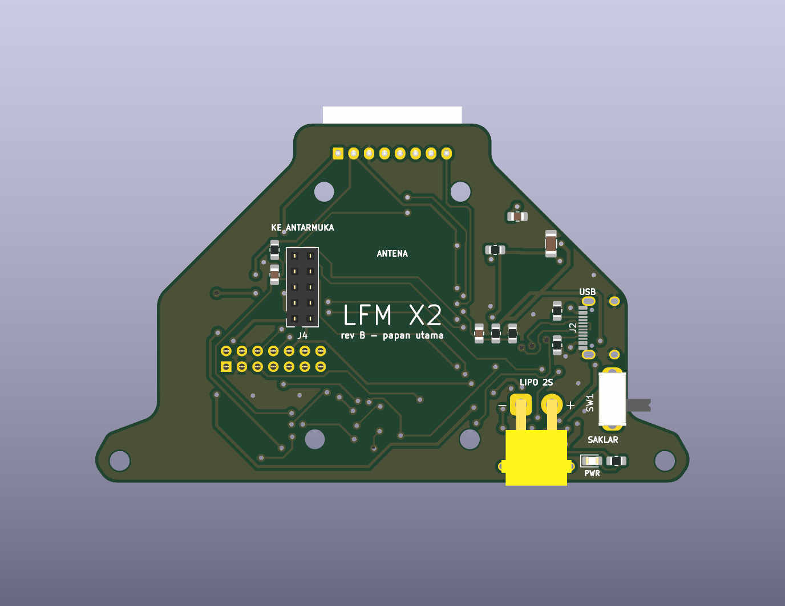
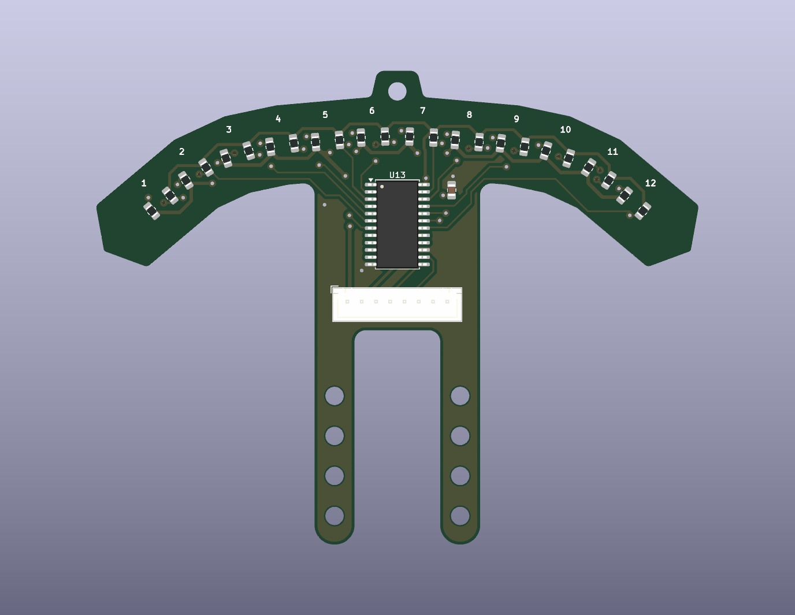
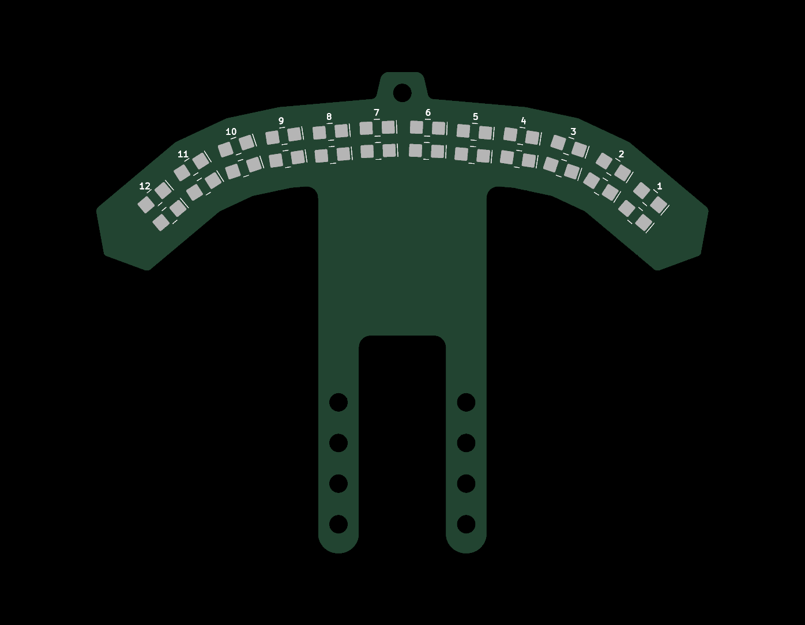

# LFM X2 rev B: 4 papan full SMD gaya Ichibot (side project)

Dimulai 15/11/2026. **Side project di luar RAB PjBL, dana sendiri**: rancangan utama (PCB sensor rev B + PCB utama
rev B + board interface rev B, RAB Rp937.390, charter) tidak berubah.

**Rev B (rombak 15/11)** meniru susunan Ichibot Ultimate 5 Max: papan utama segitiga (ESP32 dan hampir semua komponen
di sisi bawah), papan antarmuka (OLED + tombol) ditumpuk di atasnya, papan driver 4× BTN7971B di bawah bagian
belakangnya, papan sensor bulan sabit di depan, baterai LiPo 2S kecil di dudukan 3D print di atas motor. Rev A (satu
PCB memanjang) dipindah ke `arsip/hardware/lfm-x2-rev-a/`.

**Status (16/11 sore): skematik keempat papan selesai (ERC 0), dan keempat papan sudah dirouting Claude atas
permintaan user ("ROUTING SEMUA PCB SEKARANG"). Hasilnya di "Routing keempat papan".** Rombak 16/11: ESP32 membujur di
tengah papan utama dengan antena ke depan, sensor jadi **12× QRE1113GR**, kabel sensor jadi **JST XH 8 pin**. Tiap
papan = proyek KiCad sendiri (lihat "Isi folder").

Rakitan 3D terbaru (keempat papan, motor, bagian cetak): https://claude.ai/artifact/NV6wvHKBGvuGv3AQEQm5ZU.
Gambar susunan di bawah dibuat 15/11, sebelum rombak 16/11 (masih FFC, ESP32 melintang di bahu kiri); posisi papan,
lubang, dan tinggi tumpukan masih berlaku.


## Keputusan user
| Tanggal | Hal | Pilihan |
|---|---|---|
| 15/11 | Kedudukan | side project paralel, dana sendiri |
| 15/11 | MCU | modul ESP32-WROOM-32E + CH340C + USB-C + auto-reset + LDO 3,3 V di papan |
| 15/11 | Driver motor | 4× BTN7971B (TO-263-7), 2 setengah H-bridge per motor |
| 15/11 | Susunan | gaya Ichibot: papan utama segitiga + antarmuka + driver terpisah + sensor bulan sabit, LiPo 2S kecil |
| 15/11 | Sensor | **12 sensor**, fototransistor **Everlight PT67-21B** (3528 PLCC, lensa hitam, 940 nm) + **LED IR 940 nm 3528** (8 mW/sr @100 mA, temuan user); photodioda 3528 tidak ketemu |
| 15/11 | OLED | 0,96" I2C |
| 15/11 | Konektor baterai | **XT30**: jantan siku XT30PW-M di papan utama, pack LiPo memakai XT30 betina |
| 15/11 | Saklar daya | **tetap saklar geser SW1** (tombol tactile ber-LED + soft latch ESP32 dipertimbangkan, tidak dipakai) |
| 16/11 | Konektor motor | driver J2/J3 = JST XH 6 pin **siku** (S6B-XH-A), dipindah user |
| 16/11 | Tata letak utama | **ESP32 membujur di tengah, antena ke depan** (dulu melintang di bahu kiri, hasil routing dinilai jelek) |
| 16/11 | Sensor | **12× QRE1113GR** menggantikan PT67-21B + LED IR 3528 (sama dengan PCB sensor jalur utama) |
| 16/11 | Kabel sensor | **JST XH 8 pin**: siku di sisi bawah papan utama, tegak di papan sensor (menggantikan FFC) |
| 16/11 | Routing | **Claude merouting keempat papan** (dulu antarmuka, driver, sensor akan digambar user) |

## Isi folder
| Path | Isi |
|---|---|
| `utama/lfm-x2-utama.kicad_pro` | papan utama: daya (saklar beban, buck 5 V, LDO 3,3 V), ESP32, USB-C + CH340C, 3 konektor antar-papan. 50 komponen (34 di sisi bawah) |
| `antarmuka/lfm-x2-antarmuka.kicad_pro` | OLED di socket, 7 tombol (ATAS/OK/BAWAH, KEMBALI/START/LANJUT, RST), buzzer. 22 komponen |
| `driver/lfm-x2-driver.kicad_pro` | 4× BTN7971B + R/C, elko 100 µF, 2 konektor motor + encoder. 28 komponen |
| `sensor/lfm-x2-sensor.kicad_pro` | 12 QRE1113GR U1–U12 (sisi bawah), 24 resistor, CD74HC4067M U13, JST XH 8 tegak. 39 komponen |
| `<papan>/lfm-x2-<papan>-skematik.pdf` | skematik |
| `<papan>/lfm-x2-<papan>-peta-rakit-atas.pdf`, `-bawah.pdf` | lapisan Fab (referensi + nilai) skala 2:1 untuk menyolder; sisi bawah dicermin |
| `<papan>/net-harapan.json` | net tiap pin menurut generator, dipakai `cek_net_x2.py` |
| `lfm-x2.kicad_sym` | simbol bersama: `BTN7971B`, `CH340C_3V3` (pin V3 pasif), `MP1584EN` |
| `lfm-x2.pretty/` | footprint bersama: `PLCC-2_3528_HandSolder` (LED IR / PT67-21B, tidak dipakai lagi sejak 16/11) |
| `lfm-x2.3dshapes/` | model 3D kotak XT30PW-M (STEP pustaka KiCad tidak terpasang di laptop) |
| `gambar/` | `x2b-susunan.png` (tampak atas bertumpuk + tampak samping), render 3D tiap papan |

Tiap proyek: net class Default 0,3 mm, Daya 0,5 mm, Daya besar 1,2 mm; jarak 0,3 mm; via 1,3/0,6; `.kicad_dru` jarak
ke pour 0,5 mm (aturan tempat cetak).

Skrip (di `hardware/tools/`, jalankan dari folder repo; `KPY="C:/Program Files/KiCad/10.0/bin/python.exe"`):
```
py hardware/tools/gen_lib_x2.py [xt30]                   # simbol + footprint bersama (xt30: model 3D XT30 saja)
py hardware/tools/gen_sch_x2.py [papan ...] [--paksa]    # skematik (menimpa; UUID simbol dipertahankan)
py hardware/tools/cek_net_x2.py [papan ...]              # ERC + net tiap pin + konektor antar-papan
"$KPY" hardware/tools/gen_pcb_x2.py tata [papan ...]     # tata letak awal (papan utama dulu)
"$KPY" hardware/tools/gen_pcb_x2.py peta [papan ...]     # peta rakit PDF
"$KPY" hardware/tools/gen_pcb_x2.py pour papan           # GND pour dua sisi sesudah routing
```
Router papan utama (`x2_router.py` + `x2_cari.py`) ada di `hardware/tools/autoroute/`, cara pakai di README sana.
**Sesudah mulai menggambar jalur, jangan jalankan `tata` lagi** untuk papan itu: perintah itu membuat ulang papan dari
nol (skrip menolak kalau papan sudah berisi jalur, kecuali `--paksa`). Kalau skematik diubah sesudah routing, pakai F8
di KiCad.

## Susunan dan konektor antar-papan
Koordinat robot: x ke kanan, y maju, (0, 0) = tengah poros roda; KiCad X = 200 + x, Y = 180,55 − y di keempat proyek,
jadi papan bisa ditumpuk langsung dari koordinatnya.

| Papan | Ukuran | z (mm dari lantai) | Dipasang ke |
|---|---|---|---|
| sensor | 105 × 83 mm, bulan sabit + leher garpu | 4,5 … 6,1 | lengan leher (x ±11) ke lubang papan utama (±11; 67) lewat spacer 12,5 mm; baut skid nilon di tonjolan depan (0; 134,3) |
| driver | 95 × 37,5 mm, 2 telinga | 6,0 … 7,6 | header 2×7 ke socket papan utama + 2 telinga (±44; 23,5) spacer 11 mm ke telinga papan utama dan rangka |
| utama | 96 × 58 mm, segitiga | 18,6 … 20,2 | telinga (±44; 23,5) ke rangka 3D print |
| antarmuka | 78 × 58 mm | 31,2 … 32,8 | header 2×5 ke socket papan utama + 4 spacer 11 mm di (±12,5; 27) dan (±11; 67) |

Jarak 11 mm = socket 8,5 mm + plastik header 2,54 mm. Leher sensor punya 4 lubang tiap sisi berjarak 7 mm
(y 60/67/74/81): lubang 67 = posisi rancangan; memakai lubang lain menggeser busur sensor +7 / −7 / −14 mm.

| Konektor | Pin (net) | Cek |
|---|---|---|
| utama J3 (sisi bawah, JST XH 8 siku S8B-XH-A, mulut ke depan) ↔ sensor J1 (sisi atas, JST XH 8 tegak B8B-XH-A) | 1 +5V, 2 +3V3, 3 GND, 4–7 MUX_S3…S0, 8 MUX_SIG (urutan sama dengan J1 PCB sensor jalur utama) | pin bernomor sama segaris di x (−8,75 … 8,75), kabel housing–housing lurus tanpa terpuntir, ±4 cm |
| utama J4 (atas, socket 2×5 membujur di kiri ESP32, pin 1 di (−15,77; 46,5)) ↔ antarmuka J1 (bawah, header 2×5) | 1 +5V, 2 +3V3, 3 GND, 4 SDA, 5 GND, 6 SCL, 7 EN, 8 BUZ, 9 BTN, 10 BTN2 (urutan 16/11) | posisi pin + net dicek sama |
| utama J5 (bawah, socket 2×7 melintang di kiri belakang ESP32) ↔ driver J1 (atas, header 2×7) | 1–2 VBAT, 3–4 GND, 5 ML_IN1, 6 ML_IN2, 7 MR_IN1, 8 MR_IN2, 9 DRV_EN, 10 +3V3, 11–14 ENC_L_A/B, ENC_R_A/B | posisi pin + net dicek sama |

## Rangkaian
1. **Daya (utama)**: J1 XT30 LiPo 2S (pin 1 = GND di sisi bersudut miring, pin 2 = BAT+ di sisi rata; tanda +/− di
   silkscreen) → Q1 AO3401A (saklar beban sisi atas, SW1 hanya dialiri arus gate) → VBAT → J5 ke
   driver + C3/C4 + U4. U4 MP1584EN membuat 5,31 V (R6/R7 220k/39k, ±900 kHz, L1 15 µH), lewat D2 SS14 ke +5V; USB
   (VBUS) lewat D3 ke +5V juga, jadi papan hidup dari USB tanpa baterai (motor tidak). U3 AMS1117-3.3 → +3V3.
   VBAT_SENSE = VBAT × 33/133 ke GPIO39 (C2 100 nF).
2. **MCU (utama)**: ESP32-WROOM-32E, CH340C dicatu 3,3 V (V3 disambung ke VCC), auto-reset 2× SS8050, tombol BOOT di
   sisi bawah papan utama, tombol RST di papan antarmuka (net EN lewat J4). Pull-down 10k di DRV_EN (GPIO2): driver
   mati saat boot. Buzzer diam saat boot oleh R 10k basis Q1 di papan antarmuka (BUZ di GPIO27, bukan pin strapping;
   GPIO12 lepas, pull-down internalnya menjaga flash 3,3 V).
3. **Driver**: U1/U2 motor kiri, U3/U4 motor kanan. Tiap chip: R 4,7k seri di IN dan INH, R_SR 1k, R_IS 1k ke GND
   (arus belum dibaca), C 470 nF di VS; C5 100 µF di VBAT. INH keempat chip = DRV_EN. Maju: IN1 = PWM, IN2 = 0;
   mundur: kebalikannya; rem: keduanya sama. Encoder N20 dicatu 3,3 V dari J2/J3 pin 2.
4. **Sensor** (16/11, sama dengan PCB sensor jalur utama): tiap titik = QRE1113GR, LED IR (pin 1 anoda ← R 220 Ω ←
   +5V, ±17 mA; pin 2 katoda → GND) + fototransistor (pin 3 kolektor ← R 10k ← +3V3 = sinyal Sn; pin 4 emitor → GND).
   Gelap (garis hitam) = arus kecil = tegangan Sn tinggi. S1–S12 = I2–I13 CD74HC4067M U13, COM → MUX_SIG (GPIO36).
   Posisi 12 titik = busur PCB sensor rev B (`hardware/sensor-garis/REVISI.md`): tengah kemasan di titik busur, LED di
   depan, sumbu panjang sepanjang busur; R 220 dan 10k di sisi atas, di sisi busur tempat pad pasangannya.
5. **Antarmuka**: OLED 0,96" I2C di socket J2 (deret pin di belakang, modul diputar 180°: balik tampilan di firmware),
   5 tombol tangga resistor di GPIO34 (ATAS 1k, BAWAH 3,9k, KEMBALI 8,2k, OK 18k, LANJUT 39k; pull-up 10k), START
   sendiri di GPIO35, buzzer aktif + SS8050 di GPIO27.

### Pin ESP32 (disusun ulang 16/11 untuk routing papan utama)
| Fungsi | GPIO | | Fungsi | GPIO |
|---|---|---|---|---|
| MUX_SIG | 36 | | **ML_IN1 / ML_IN2** | **13 / 21** |
| VBAT_SENSE | 39 | | **MR_IN1 / MR_IN2** | **15 / 19** |
| MUX_S0 / S1 / S2 / S3 | 26 / 25 / 33 / 32 | | **DRV_EN** (INH 4 chip) | **2** |
| BTN (tangga 5 tombol) / BTN2 (START) | 34 / 35 | | **ENC_L A / B** | **4 / 18** |
| **Buzzer** | **27** | | **ENC_R A / B** | **16 / 5** |
| **I2C SDA / SCL** | **22 / 23** | | UART0 ke CH340C | 1 / 3 |

Kenapa disusun ulang (16/11): dengan ESP32 di tengah, peta lama (motor 4/16/17/18, encoder 13/14/23/19, SDA 21)
membuat jalur deret kaki kiri saling silang dengan urutan J5: 34 sinyal ESP32 saja masih 12 tabrakan di router.
Sekarang urutan kaki kiri (belakang → depan) searah pin J5/J4: ENC_L_A (IO4) masuk J5.11 dari belakang, ENC_R_A
(IO16) dan ENC_R_B (IO5) lurus ke J5.13/J5.14, ENC_L_B/MR_IN2/ML_IN2 (IO18/19/21) masuk baris atas J5 dari depan,
DRV_EN/MR_IN1/ML_IN1 (IO2/15/13) dari deret belakang lewat bawah J5, SDA/SCL (IO22/23) lurus ke J4.4/J4.6. Urutan J4
ikut diubah (papan antarmuka dirouting ulang). BUZ di IO27 (deret kanan, kaki 12): jalurnya naik ke sisi atas dan
menyeberang di atas modul bersama EN/BTN/BTN2 ke ujung depan J4 (dari deret kiri, jalur BUZ harus memotong jalur ke
J5 dan SDA/SCL). Catatan pin strapping: IO15 (MR_IN1) HIGH saat boot dan IO5 (ENC_R_B) ikut dibaca saat reset, aman
karena INH keempat chip ditahan LOW oleh pull-down DRV_EN; GPIO12, 14, 17 lepas. Driver dan sensor tidak berubah.

`Pins.h` X2 nanti beda dari jalur utama di bagian motor: 4 kanal PWM (20 kHz, di bawah batas 25 kHz BTN7971B) + 1 pin
enable.

## Tata letak (ringkas)
- **Utama** (rombak 16/11): ESP32 di sisi bawah, **membujur di tengah, antena ke depan** (modul y 34,7…60,2;
  daerah antena x ±9,6, y 53,4…61,0 tanpa jalur, via, dan pour di kedua sisi). Di depannya lorong ±5 mm sampai lubang
  H5/H6 untuk jalur dari J3. Deret kaki 1–14 (EN, MUX, VBAT_SENSE, BTN, BTN2, BUZ) di kanan,
  25–38 (encoder, IN motor, RX/TX, SDA/SCL) di kiri, 15–24 di belakang (DRV_EN, MR_IN1, ML_IN1). Kiri: socket J4
  antarmuka (atas, membujur), J5 driver (bawah, melintang di kiri belakang), LDO U3 + C13. R14/C12 (RC EN) di sisi atas
  kiri J4. Kanan deret 1–14: **fanout tetap** (`autoroute/x2_fanout_utama.json`): via kaki 2–7 dan 12 berselang dua
  kolom, lajur 4 MUX_S di sisi bawah dan MUX_SIG di sisi atas lurus ke J3, C14 (100 nF 3V3) di sisi bawah di depan
  kaki 1, pembagi VBAT di sisi atas (ketiga pad VBAT_SENSE sebaris di belakang), C11 (100 nF CH340C) di belakang U2. Buck MP1584 (U4 diputar 90°, C5 di antara kaki SW dan BST, D1/L1 di kanan
  belakang, C3/R5 di depan, R7/R8/C7 di belakang; C4, C6, R6 di sisi atas) dan CH340C di sisi bawah; USB-C J2 dan SW1
  di bahu kanan (atas), R CC di ujung fanout USB-C. Kanan belakang: J1 XT30 siku (atas, mulut ke baterai, 0,55 mm melewati tepi) + LED daya, Q1 (bawah). Tengah
  belakang: auto-reset Q2/Q3; kiri belakang: BOOT SW2. Ujung segitiga: J3 JST XH 8 siku (bawah), mulut ke depan
  menonjol 3,3 mm. Lubang H5/H6 (±11; 67) di samping antena: **pakai spacer/baut nilon**.
- **Antarmuka**: OLED di tengah, tombol 3 + 3 mengapitnya, RST di tab depan, buzzer di tab belakang (tidak di bawah
  OLED karena tinggi 9,5 mm). J1 di sisi bawah kiri, tepat di atas J4 papan utama.
- **Driver**: 4 BTN7971B berjajar, tab ke belakang, R/C tiap chip sebaris di depan kakinya, J2/J3 siku di tepi
  belakang, elko C5 di tengah. Bagian tengah dilebarkan ke x ±30 supaya J1 ikut pindah ke kiri.
- **Sensor**: 12 QRE1113GR di sisi bawah, nomor 1–12 di silkscreen kedua sisi (1 = paling kiri dilihat dari atas). Mux
  U13 di leher, JST XH J1 tegak di bawahnya, tepat di depan celah garpu.

 
 
 

## Routing keempat papan (16/11)
Dirouting Claude dengan router sendiri (`hardware/tools/autoroute/x2_router.py` + `x2_cari.py`; FreeRouting 2.1
tidak mau menulis hasil di papan utama). Permintaan user: "se simpel dan se safe spacing mungkin", lalu sesudah
rombak: "ROUTING SEMUA PCB SEKARANG". Semua papan dirouting ulang dari nol sesudah tata letak 16/11 sore.
- **Jarak**: minimal 0,3 mm ke tembaga net lain (aturan proyek; tempat cetak 0,254), router mengambil 0,4 mm kalau
  ada ruang. Pour GND berjarak 0,5 mm (aturan tempat cetak), tebal minimum 0,35 mm.
- **Lebar** (bawaan router): VBAT/BAT+ dan keluaran motor ML_P/ML_N/MR_P/MR_N 1,0 mm, BUCK_SW 0,8,
  +5V/+5V_BUCK/VBUS 0,6, +3V3 dan GND 0,5, sinyal 0,3 mm. Papan utama terlalu padat untuk itu: VBAT 0,6 (jalur tetap
  VBAT di tepi belakang tetap 1,0), BUCK_SW 0,6, +5V/+5V_BUCK/VBUS 0,5, +3V3 0,4. GND baterai: jalur tetap 1,0 mm dari
  kaki GND XT30 ke pour tepi belakang (2 via), lalu lewat pour kedua sisi ke J5. Lebih kecil dari net class "Daya
  besar" 1,2 mm: cukup untuk arus rata-rata ±0,5 A, motor macet (±3 A sesaat) masih aman untuk jalur pendek 1 oz.
- **Hasil** (papan utama selesai 17/11):

  | Papan | Segmen (atas / bawah) | Panjang jalur | Via | Lebar dipakai (mm) |
  |---|---|---|---|---|
  | Utama | 601 (269 / 332) | 1,56 m | 83 | 0,3 · 0,4 · 0,5 · 0,6 · 1,0 |
  | Antarmuka | 155 (133 / 22) | 0,43 m | 13 | 0,3 · 0,5 · 0,6 |
  | Driver | 306 (211 / 95) | 0,79 m | 38 | 0,3 · 0,5 · 1,0 |
  | Sensor | 361 (256 / 105) | 0,75 m | 51 | 0,3 · 0,5 · 0,6 |

- **Jalur tetap papan utama** (dipasang sebelum router, file di `hardware/tools/autoroute/`): VBAT 1,0 mm di tepi
  belakang + GND XT30 (`x2_vbat_utama.json`); fanout deret kanan ESP32, C14, lajur MUX ke J3, GND USB-C (pad A1/B12,
  A12/B1 ke kaki SH), CC1/CC2 ke R10/R11, GND R10/R11 dan kaki 1 CH340C ke kaki SH (`x2_fanout_utama.json`); dua
  sambungan ratsnest yang pasti bersilang diganti pasangan lain (`x2_sambungan_utama.json`, `ekspor --ganti`).
- **Perubahan tata letak demi routing utama (17/11)**: C11 pindah ke belakang U2 (lajur +5V_BUCK), R3 diputar (pad
  VBAT_SENSE sebaris), C14 diputar (pad GND langsung ke kaki 1, pad +3V3 lewat via sendiri), MUX_SIG belok di y 64,6
  (celah +3V3/EN di depan antena), R10/R11 (resistor CC) tegak dengan pad GND menghadap kaki SH USB-C. Sebabnya: pad
  GND yang terkurung jalur sinyal lepas dari pour (router tidak melihat pour), jadi GND di titik sempit disambung
  dengan jalur tetap, bukan diandalkan ke pour.
- **Aturan tambahan** (`.kicad_dru`, dari `gen_sch_x2.py`): rule area "Bawah ESP32" (sisi bawah di bawah badan
  modul: tanpa jalur dan via, pour boleh); `usb_c_fanout_0,2` (peringatan untuk celah jalur fanout USB-C 0,2–0,25 mm
  sepanjang ±0,6 mm dari ujung pad, sama dengan celah antar pad konektor); `thermal_satu_jari` (pad THT SW1, kaki
  pelindung J2, kaki GND J3/J4, dan kaki GND XT30 J1 cukup 1 jari thermal).
- **Kalau mengubah papan**: buka di KiCad, ubah, lalu `x2_router.py pour` (bukan pour bawaan KiCad dengan setelan
  lain) dan DRC. Routing ulang dari nol: `gen_pcb_x2.py tata <papan> --paksa` lalu langkah di README autoroute.
- **Antena**: area aturan "Antena ESP32" (x −9,6 … 9,6; y 53,4 … 61,0) melarang jalur, via, dan pour di kedua sisi.
  Keepout bawaan footprint (48 × 21 mm, ikut melarang footprint) dibuang karena menutup lubang dan J3. Antena di
  tengah papan dengan pour GND di kiri-kanan dan papan sensor/antarmuka di atas-bawahnya: **jangkauan Wi-Fi lebih
  pendek** dari antena di tepi (USB tetap jalan; cukup untuk Wi-Fi jarak dekat ke laptop, belum diuji).
- **Jangan "Update Footprints from Library"** untuk utama U1 (via termal bor 0,2 mm, keepout, dan courtyard antena
  dibuang), SW1 (pad pemasang dikecilkan ke 2,0 × 3,3 supaya jarak ke kaki ≥ 0,3 mm), J2 (garis silk dipindah ke
  Fab) dan J1 (garis silk badan ke Fab, model 3D kotak). Peringatan "footprint beda dari pustaka" di papan sensor hanya pembulatan rotasi miring, aman.

## Daftar komponen (keempat papan)
Harga dari pencarian Tokopedia 15/11/2026 (bisa berubah; harga rev B dari cuplikan hasil pencarian karena halaman
produk tidak bisa dibuka dari laptop); "belum dicari" = harga belum ada. PT67-21B dan LED IR 3528 tidak muncul di
pencarian: link listing temuan user belum dicatat.

| Komponen | Papan: ref | Jml | Harga satuan | Toko / catatan |
|---|---|---|---|---|
| ESP32-WROOM-32E (4 MB, antena PCB) | utama: U1 | 1 | Rp50.000 | [WNT Electronics](https://www.tokopedia.com/wnte/esp32-wroom-32e); bukan varian IPEX (32UE) |
| BTN7971B TO-263-7 | driver: U1–U4 | 4 | Rp45.000 | [Jogjarobotika](https://www.tokopedia.com/jogjarobotika/btn7971b-to263-driver-motor-ic-btn7971-btn-7971); cadangan [Nugarada](https://www.tokopedia.com/nugarada/btn7971b-btn-7971-b-btn7971-b-to263-driver-motor-ic) Rp60.000 |
| QRE1113GR SMD | sensor: U1–U12 | 12 | Rp15.000 | [Shopee](https://shopee.co.id/product/12793026/28316976609), sama dengan jalur utama (`docs/charter.md` bagian 8) |
| CD74HC4067M SOP-24 lebar (SOIC) | sensor: U13 | 1 | Rp20.000 | WKH Electronic, sama dengan jalur utama; hindari SSOP |
| CH340C SOP-16 | utama: U2 | 1 | Rp8.500 | [DR Elektronik](https://www.tokopedia.com/elektronikdr/ic-ch340c-usb-to-serial-chip-sop-16-ch340g-ch340-ch-340-sop16-wch); harus **C**, bukan G |
| USB-C 16 pin SMD | utama: J2 | 1 | Rp3.000 | [Jogjarobotika](https://www.tokopedia.com/jogjarobotika/konektor-connector-soket-socket-tipe-type-c-female-usb-3-1-16p-smd); cocokkan dengan footprint HRO TYPE-C-31-M-12 |
| MP1584EN SOP-8 (pad bawah) | utama: U4 | 1 | Rp7.500 | [Central Electronics](https://www.tokopedia.com/celectro/ic-smd-mp1584-mp1584en-3a-1-5mhz-28v-step-down-converter-sop8-ic-bc00) |
| AO3401A SOT-23 | utama: Q1 | 1 | Rp1.650 | [Lisu Instruments](https://www.tokopedia.com/lisuinstrument/ao3401a-ao3401-30v-4a-p-channel-mosfets-sot-23-alpha-omega-original) |
| Tombol tactile SMD 6×6, 4 kaki | antarmuka: SW1–SW7, utama: SW2 | 8 | Rp8.000 / 10 pcs | [ichibot](https://www.tokopedia.com/ichibot/push-button-tact-switch-micro-switch-6x6x5-smd-4p-4-pin-6-6-5-tombol) |
| JST XH 8 pin: header **siku** S8B-XH-A + header tegak B8B-XH-A + 2 housing + terminal, kabel ±4 cm | utama: J3, sensor: J1 | 1 set | Rp5.000 (perkiraan RAB jalur utama, versi tegak) | [s3-satriasecure](https://www.tokopedia.com/s3-satriasecure/molex-mini-8pin-2-54-molek-2-54mm-header-8-pin-jst-xh-2-54-mm-soket-8p-terminal-8p-8-pin-konektor-connector-8-p-kaki-8pin-konector-conektor-8kaki-8lubang-8-lubang-jalur-8jalur-1731323197141649188); **versi siku belum dicari** |
| Pin header 2×5 / 2×7, 2,54 mm | antarmuka: J1 / driver: J1 | 1 / 1 | belum dicari | |
| Socket female 2×5 / 2×7 (tinggi 8,5 mm) / 1×4 | utama: J4 / J5, antarmuka: J2 | 1 / 1 / 1 | belum dicari | |
| Spacer M3 11 mm / 12,5 mm (atau 12 mm + ring) | | 6 / 2 | Rp1.320 (nilon 11 mm) | antarmuka 4, driver 2 / leher sensor 2. Nilon M3 6/11/15 mm di Unique-Electronics; kit kuningan M3 180 pcs (ada 10 dan 12 mm) Rp58.000 di [TacTic Tools](https://www.tokopedia.com/tactic/baut-stand-off-spacer-kit-pcb-motherboard-kuningan-m3-set-180-pcs). H2 telinga kiri dekat antena: pakai nilon |
| Induktor daya SMD 15 µH ≥ 2 A, CD75 | utama: L1 | 1 | ± Rp3.000 | 10–22 µH juga bisa |
| AMS1117-3.3 SOT-223 | utama: U3 | 1 | ± Rp1.500 | |
| SS34 / SS14 (SMA) | utama: D1 / D2, D3 | 1 / 2 | ± Rp500 | |
| SS8050 SOT-23 | utama: Q2, Q3, antarmuka: Q1 | 3 | ± Rp300 | |
| Elko SMD 100 µF 16 V, 6,3 × 5,4 mm | driver: C5 | 1 | ± Rp1.000 | |
| Kapasitor 1206: 10 µF 25 V / 22 µF 16 V | utama | 3 / 2 | ± Rp500 | |
| Kapasitor 0805: 100 nF / 470 nF / 1 µF / 150 pF | | 10 / 4 / 1 / 1 | ± Rp100 | |
| Resistor 0805: 220 / 1k / 3,9k / 4,7k / 5,1k / 8,2k / 10k / 18k / 33k / 39k / 100k / 220k | | 12 / 11 / 1 / 8 / 2 / 1 / 22 / 1 / 1 / 2 / 4 / 1 | ± Rp100 | 66 buah |
| LED 0805 hijau | utama: LED1 | 1 | ± Rp200 | |
| Saklar geser SPDT siku OS102011MA1Q | utama: SW1 | 1 | ± Rp1.500 | THT, jarak kaki 2,0 mm |
| XT30PW-M (XT30 jantan, PCB siku) | utama: J1 | 1 | ± Rp7.500–10.000 | pencarian "XT30PW male tanam pcb" ([Tokopedia](https://www.tokopedia.com/find/konektor-xt30)); pastikan **PW-M siku**, bukan steker kabel atau versi tegak (UPB) |
| JST XH 6 pin (header + housing) | driver: J2, J3 | 2 | Rp5.000 / set | THT |
| Buzzer aktif 5 V 12 × 9,5 mm | antarmuka: BZ1 | 1 | Rp3.000 | THT |
| OLED 0,96" I2C | | 1 | Rp36.500 | sama dengan jalur utama |
| Motor N20 6 V 500 RPM + encoder | | 2 | Rp55.000 | sama dengan jalur utama |

Yang sudah ada harganya: **± Rp610.000** (rev B 15/11 Rp425.000 + 12 QRE1113GR Rp180.000 + set JST XH 8 Rp5.000); pasif dan komponen kecil ± Rp40.000.
Belum termasuk header siku JST XH 8, header/socket 2,54 mm, spacer, LiPo, cetak 4 PCB, rangka 3D print, roda.

## Pilihan yang diambil Claude (bisa diubah)
- **Tinggi susunan** 11 mm (header + socket 2,54 mm biasa) untuk antarmuka dan driver; sensor 12,5 mm di bawah papan
  utama. Sensor ke papan utama lewat kabel **JST XH 8 pin** (16/11, keputusan user; dulu FFC seperti Ichibot).
- **Leher sensor** 4 lubang berjarak 7 mm untuk menggeser busur maju/mundur.
- **OLED diputar 180°** (deret pin di belakang) supaya socket tidak menabrak J1 di depan; tampilan dibalik di firmware.
- **Tombol BOOT di sisi bawah papan utama** (jarang dipakai karena ada auto-reset), RST di tab depan papan antarmuka.
- **R LED 220 Ω, R fototransistor 10k**: sama dengan PCB sensor jalur utama.
- **QRE di sisi bawah, resistornya di sisi atas** (via di tiap titik), supaya muka sensor rata dan dekat lantai.
- Saklar beban AO3401A, R seri 4,7k di IN/INH, pembagi 100k/33k, buck 5,31 V, cas di luar robot: sama dengan rev A.

## Belum dicek / perlu diukur sebelum cetak
1. **USB-C 16 pin di bawah aturan tempat cetak**: celah pad 0,2 mm < 0,3 mm. SPECTRA pcb (17/11): boleh dicetak,
   risiko pemesan; **keputusan user: tetap dipakai**. Sebelum menyolder, cek short antar pad dengan kaca pembesar /
   multimeter, kerik pakai cutter kalau nyambung; solder pakai flux + drag. Lubang sudah ikut aturan SPECTRA (via bor
   0,7, slot kaki pelindung 1,0, pasak 0,7; `docs/aturan-cetak-pcb.md`).
2. **LiPo 2S**: konektor **XT30** (keputusan user 15/11), packnya belum dipilih. Calon dari pencarian Tokopedia
   15/11 (cuplikan hasil, belum dicek di halaman produk):

   | Pack | Harga | Data | Konektor |
   |---|---|---|---|
   | [Tattu 2S 300 mAh 75C HV](https://www.tokopedia.com/alladinshop/baterai-battery-lipo-tattu-7-4v-300mah-2s-75c-hv-4-35v-xt30-drone-rc) (My Aladin) | Rp165.000 | 47 × 17 × 13 mm, 17 g, LiHV 4,35 V/sel | XT30 |
   | GAONENG GNB LiHV 2S 300 mAh 60C (CRtoys) | Rp120.750 | LiHV | JST (jenis belum pasti) |
   | CNHL MiniStar 2S 350 mAh 70C | Rp64.900 | | belum terlihat |
   | Gens Ace 2S 520 mAh 30C | Rp125.000 | | belum terlihat |
   | CODDAR 2S 500 mAh 100C LiHV (Cinegriptools) | Rp130.095 | LiHV | XT30 |

   Kebutuhan: arus rata-rata ±0,5 A (3–4 W, `docs/perhitungan-motor.md`), jadi 300 mAh ±35 menit, cukup untuk match
   5 menit. Dudukan di atas motor menyediakan ±55 × 30 mm. LiHV penuh 8,7 V masih di bawah 9,2 V (8,2 V + 1 V
   guidebook) tapi butuh charger mode LiHV; bisa juga dicas biasa sampai 8,4 V. Pack harus ber-XT30 **betina** (umum di pack
   drone); pack ber-JST perlu disolder ulang ke XT30. Polaritas XT30 dikunci bentuk rumah (sisi rata = +), tapi tetap
   cek kabel merah pack ke + sebelum dicolok pertama kali (papan tanpa proteksi polaritas terbalik). Steker + kabel
   butuh ±15 mm di belakang tepi papan utama (sampai y ≈ 4, tinggi z 20–26): dudukan baterai jangan menutup ruang
   itu. Cek juga istilah baterai di guidebook (butir A.e menulis Li-ion).
3. **QRE1113GR**: cek tanda pin 1 tiap sensor dan uji di breadboard sebelum disolder (LED IR dilihat lewat kamera
   HP), sama dengan jalur utama.
4. **JST XH 8 siku** (utama J3) belum dicari di toko lokal; kalau tidak ada, header tegak bisa dipakai dengan kabel
   ditekuk (badan tegak 8,5 mm masih di atas papan sensor 12,5 mm di bawahnya, tapi cek dulu).
5. **Ukuran mekanik**: jarak lubang modul OLED (2 lubang M2 di (±11,75; 60) dari gambar umum), tinggi socket dan
   header yang dibeli, ketersediaan spacer 11 / 12,5 mm, bracket N20.
6. **Rangka 3D print** (dudukan motor + baterai + telinga) belum digambar; tinggi sensor ke lantai (dirancang ±2,7 mm
   dari bawah komponen) ditentukan rangka + skid depan.
7. Pad bawah ESP32 (pin 39, GND) tersambung ke pour sisi bawah, tanpa via termal; GND juga ada di pin 1, 15, 38.
9. **Driver J2/J3 siku** (pilihan user 16/11) menumpuk dengan kaleng motor N20 + PCB encoder di model rakitan, dan
   steker yang masuk dari belakang jatuh di bawah motor. Versi tegak (B6B-XH-A) punya posisi pad yang sama, jadi bisa
   ditukar tanpa merouting ulang.
8. Belum ada firmware, simulasi, atau uji apa pun untuk X2.

## Hasil cek (17/11, sesudah routing)
- `cek_net_x2.py`: keempat papan ERC 0, net tiap pin cocok dengan `net-harapan.json`, 3 pasang konektor antar-papan
  (utama J3 ↔ sensor J1, J4 ↔ antarmuka J1, J5 ↔ driver J1) cocok per pin.
- DRC `kicad-cli pcb drc --schematic-parity` tiap papan: **0 error, 0 belum tersambung, parity 0**. GND tiap papan
  satu kelompok (`x2_router.py gnd`).
- Peringatan yang tersisa (disengaja atau kosmetik):
  - utama: 30 celah USB-C 0,2 mm (pad konektor + ujung fanout, aturan `usb_c_*`); 4 footprint beda dari pustaka (U1,
    SW1, J2, J1, disengaja); 1 leher pour GND 0,275 mm (< 0,3) di sudut pad, pour bukan jalur; silkscreen: referensi
    U4 di atas pad C5 dan garis L1, garis D3 di atas pad J1 (dipotong tempat cetak di atas tembaga terbuka).
  - driver: 4 courtyard J2/J3 siku menumpuk BTN7971B (pilihan user, lihat Terbuka 9), 16 silkscreen di tepi papan.
  - sensor: 4 footprint beda dari pustaka (pembulatan rotasi). Antarmuka: 0.

## Hasil cek (15/11, sebelum routing)
- `cek_net_x2.py`: keempat papan ERC 0, net tiap pin cocok dengan `net-harapan.json`, 3 pasang konektor antar-papan
  membawa net yang sama per pin.
- DRC `kicad-cli pcb drc --schematic-parity` tiap papan: **0 error, parity 0**. Sambungan belum dirouting (memang
  belum ada jalur): utama 147, antarmuka 53, driver 68, sensor 96 pad. Peringatan: utama 19 celah pad USB-C + 4
  footprint beda dari pustaka (U1, SW1, J2, J1, disengaja); sensor 10 footprint beda dari pustaka (pembulatan rotasi);
  antarmuka dan driver 0.
- Cek tumpuk (koordinat robot): pad J4 utama = pad J1 antarmuka dan pad J5 utama = pad J1 driver (posisi + net),
  pin FFC utama J3 dan sensor J1 segaris di x, lubang M3 pasangan segaris. (Sebelum rombak 16/11.)

## Referensi
Foto Ichibot Ultimate 5 Max dari user di `docs/referensi/ichibot-ultimate-5-max/`. Yang ditiru: papan utama segitiga
dengan papan tombol + OLED di atasnya, papan driver 4 BTN7971B terpisah, sensor bulan sabit dengan leher garpu
berlubang dan baut skid di depan, LiPo di atas motor (FFC sensor sempat ditiru, diganti JST XH 16/11). Yang berbeda: busur sensor X2 mengikuti PCB sensor
rev B (12 titik, lebih landai dari Ichibot), baterai 2S (Ichibot 3S melebihi batas 8,2 V ± 1 V lomba), buzzer dan
RST pindah ke papan antarmuka (Ichibot: buzzer besar di papan utama), dan tombol 6×6 biasa (Ichibot memakai tombol
tinggi bertutup).
