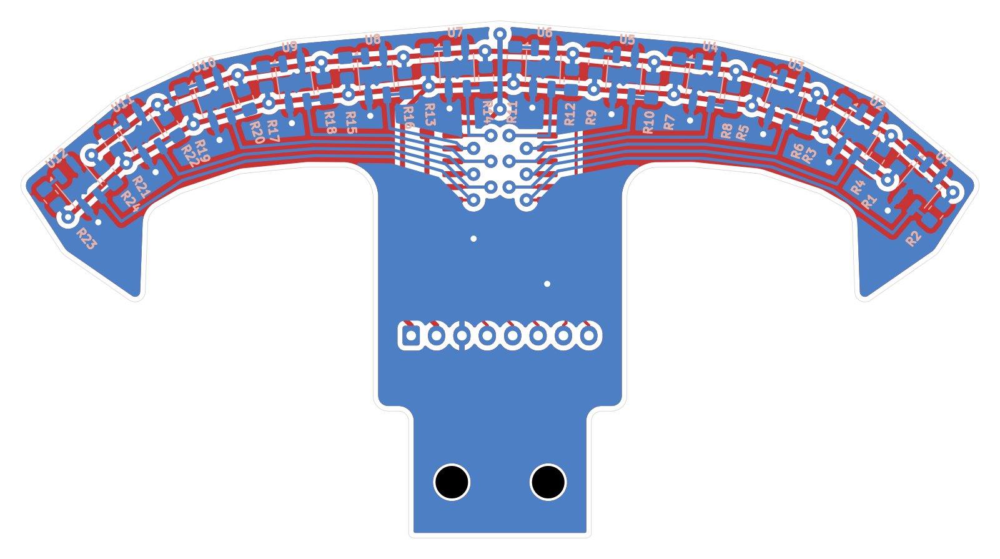

# PCB sensor garis: riwayat revisi

Proyek KiCad 10 buatan user (skematik + layout), dirapikan dan dirouting bersama Claude lewat MCP KiCad.
Buka `sensor-garis.kicad_pro`. File di folder ini selalu revisi **terbaru**; tiap revisi disalin utuh ke
`revisi/rev-X/` (file KiCad + gambar) supaya perubahan bisa dibandingkan.

## Rev B (22/10/2026), `revisi/rev-b/` = file terbaru

- **Bentuk jangkar**: pita melengkung + kait di kedua ujung (mengarah ke belakang) + tangkai 25 mm + tab 2 lubang.
  Lebar 95 mm (rev A 120), panjang tetap ±51 mm (Y 49,55–100,5). Kait sampai Y 78 (±28 mm di belakang tepi depan).
- **Sensor**: 12× QRE1113GR jarak **8 mm** (untuk garis 2 cm: kedua tepi garis bergantian melewati sensor tiap ±4 mm,
  bacaan posisi halus). Pasangan tengah ±4,25 mm (celah 8,5 untuk jalur +3V3). Segmen dari tengah ke luar
  5°, 5°, 12°, 25°, 40°: enam sensor tengah hampir lurus (presisi & persimpangan), lengan melengkung ke belakang
  (tikungan tajam). Rentang ±41,4 mm, sensor terluar mundur 11,6 mm.

  | Sensor (kanan; kiri = cermin) | U7 | U8 | U9 | U10 | U11 | U12 |
  |---|---|---|---|---|---|---|
  | x dari tengah (mm) | 4,25 | 12,22 | 20,19 | 28,01 | 35,27 | 41,39 |
  | mundur dari U7 (mm) | 0 | 0,70 | 1,39 | 3,06 | 6,44 | 11,58 |

- **Tiap grup** sama seperti rev A (R10k kiri, R220 kanan, 2,85 mm), diputar mengikuti busur.
- **Routing**: S1–S12 di B.Cu menumpuk di belakang sensor (jarak 0,7 mm) lalu ke 12 via di bawah U13; daya di
  F.Cu (+3V3 depan, +5V belakang), +3V3 menyeberang lewat B di garis tengah; pour GND dua sisi (tebal min 0,3).
  DRC 0 error / 0 unconnected (sisa 12 peringatan lib_footprint_mismatch).
- U13 tepat di garis tengah X 200, C1 diputar vertikal di samping pin 24, J1 & H1/H2 digeser 0,25 mm supaya simetris
  (H1/H2 = X ±4,75 dari tengah, Y 95).
- Skrip penataan/routing: `hardware/tools/sensor_revb_layout.py` (dokumentasi geometri; jangan dijalankan ulang).

## Rev A (22/10/2026), `revisi/rev-a/`

- **Bentuk**: outline simetris gaya "ujung panah" (`hardware/outline/`): sayap 120 mm, tepi depan miring ±11°,
  badan 30 mm, tab 18 mm dengan 2 lubang M3 (±4,75; 95).
- **Sensor**: 12× QRE1113GR di sisi bawah, jarak 9 mm (celah tengah U6–U7 19,5 mm), turun 2 mm tiap sensor
  ke arah luar. Tiap sensor: R 220 Ω (LED, dari +5V) di kanan dan R 10k (pull-up ke +3V3) di kiri, keduanya di
  sisi bawah, 2,85 mm dari tengah sensor.
- **Mux**: U13 CD74HC4067M (SOIC-24W) di sisi atas, garis tengah; I2..I13 = S1..S12 (sesuai skematik user),
  I0, I1, I14, I15 tidak tersambung. C1 100 nF di samping pin VCC.
- **J1**: JST XH 8 pin vertikal. Urutan pin (dari skematik): 1 +5V, 2 +3V3, 3 GND, 4 MUX_S3, 5 MUX_S2,
  6 MUX_S1, 7 MUX_S0, 8 MUX_SIG.
- **Routing**: sinyal S1–S12 di B.Cu (0,3 mm), rel daya +3V3/+5V di F.Cu (0,5 mm), pour GND di kedua sisi
  (jarak 0,5 mm). DRC: 0 error, 0 unconnected.

Alasan revisi berikutnya: bentuk kurang mirip jangkar, banyak ruang kosong di belakang sensor, celah tengah
19,5 mm terlalu lebar untuk garis lomba 2 cm (IARC XII), dan robot ingin dipakai serbaguna (lintasan grid dan
lintasan banyak tikungan).
