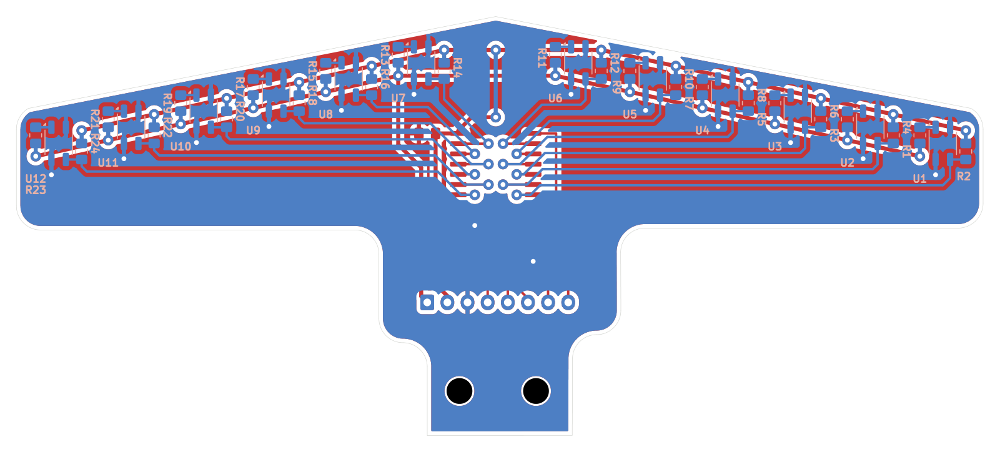

# PCB sensor garis: riwayat revisi

Proyek KiCad 10 buatan user (skematik + layout), dirapikan dan dirouting bersama Claude lewat MCP KiCad.
Buka `sensor-garis.kicad_pro`. File di folder ini selalu revisi **terbaru**; tiap revisi lama disalin utuh ke
`revisi/rev-X/` (file KiCad + gambar) supaya perubahan bisa dibandingkan.

## Rev A (22/10/2026), `revisi/rev-a/`

- **Bentuk**: outline simetris gaya "ujung panah" (`hardware/outline/`): sayap 120 mm, tepi depan miring ±11°,
  badan 30 mm, tab 18 mm dengan 2 lubang M3 (±4,75; 95).
- **Sensor**: 12× QRE1113GR di sisi bawah, jarak 9 mm (celah tengah U6–U7 19,5 mm), turun 2 mm tiap sensor
  ke arah luar. Tiap sensor: R 220 Ω (LED, dari +5V) di kanan dan R 10k (pull-up ke +3V3) di kiri, keduanya di
  sisi bawah, 2,85 mm dari tengah sensor.
- **Mux**: U13 CD74HC4067M (SOIC-24W) di sisi atas, garis tengah; I2..I13 = S1..S12 (sesuai skematik user),
  I0, I1, I14, I15 tidak tersambung. C1 100 nF di samping pin VCC.
- **J1**: JST XH 8 pin vertikal. Urutan pin (dari skematik): 1 +5V, 2 +3V3, 3 GND, 4 MUX_S3, 5 MUX_S2,
  6 MUX_S1, 7 MUX_S0, 8 MUX_SIG.
- **Routing**: sinyal S1–S12 di B.Cu (0,3 mm), rel daya +3V3/+5V di F.Cu (0,5 mm), pour GND di kedua sisi
  (jarak 0,5 mm). DRC: 0 error, 0 unconnected.

Alasan revisi berikutnya: bentuk kurang mirip jangkar, banyak ruang kosong di belakang sensor, celah tengah
19,5 mm terlalu lebar untuk garis lomba 2 cm (IARC XII), dan robot ingin dipakai serbaguna (lintasan grid dan
lintasan banyak tikungan).
